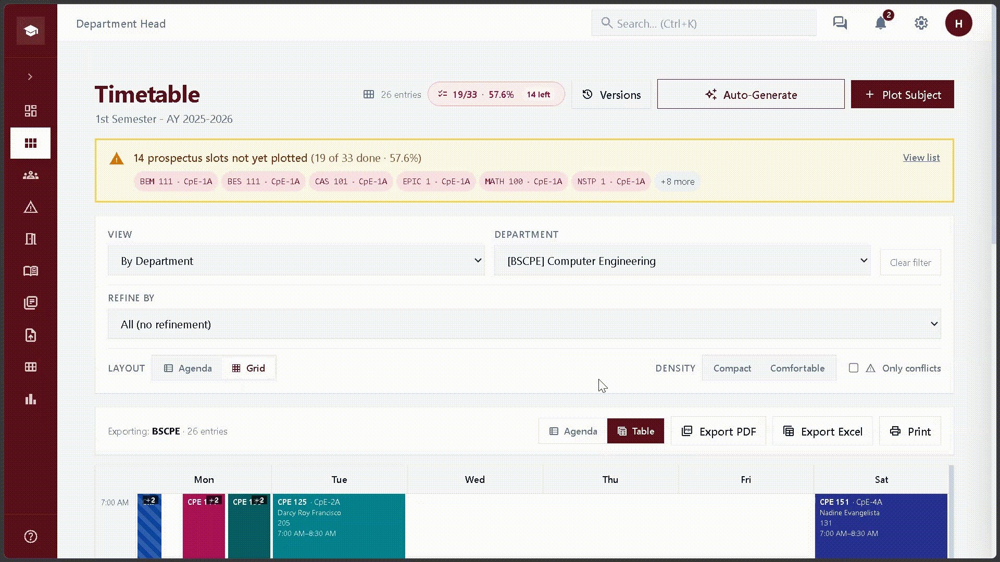

# CoE-NNECT

<!-- CI & Status Badges -->


## Tech Stack
<!-- Tech Stack Badges -->


## 📖 Table of Contents
- [Project Information](#project-information)
- [Capabilities](#capabilities)
- [Architecture](#architecture)
- [Get Started](#get-started)
- [Common Commands](#common-commands)

<p align="center">
  <strong>College of Engineering Scheduling System</strong><br>
  Western Mindanao State University<br>
  <em>CPE SD 3 — Management Information System · Academic Year 2026–2027</em>
</p>

CoE-NNECT supports academic scheduling for the College of Engineering at Western Mindanao State University (WMSU). The system provides schedule planning and validation, role-based review workflows, timetable views, reports, and related academic data management.


## Tech Stack
- **Monorepo:** pnpm workspaces
- **Backend:** NestJS, TypeORM, Supabase (PostgreSQL), Swagger
- **Frontend:** React, Vite, TailwindCSS, React Query, Zustand
- **Solver Engine:** Python CP-SAT (Google OR-Tools)
- **PDF Parser:** Python FastAPI (pypdfium2)
- **Deployment:** Railway (Backend/Solver/Parser) + Vercel (Frontend)

## Project Status

- **FR Coverage:** 78/79 (~99% complete)
- **Constraint Rules:** 27 rules, 190 passing tests
- **CI/CD:** Fully automated via GitHub Actions

## Capabilities
Here is the automatic schedule generator in action:


## Project information

|                    |                                               |
| ------------------ | --------------------------------------------- |
| **Project**        | CPE SD 3 — Management Information System      |
| **Institution**    | Western Mindanao State University             |
| **College**        | College of Engineering                        |
| **Academic year**  | 2026–2027                                     |
| **Status**         | Active development                            |
| **Project client** | Engr. Gajil J. Santos, College of Engineering |

## Project team

| Name                        | Project role                                       |
| --------------------------- | -------------------------------------------------- |
| Jazmine Elaiza L. Luis      | Project Manager                                    |
| Alrhaden A. Javier          | Lead Developer · System Architect                  |
| Giel V. Andales             | Senior Developer                                   |
| Edzel Don V. Tio            | Junior Developer · Database Initialization         |
| Roland C. Velez             | Lead Tester · Assistant Trainer · Junior Archivist |
| Andre Aga B. Dacumos        | Lead Trainer · Senior Tester                       |
| Aizzah Arabelle B. Javelosa | Lead Archivist · Assistant System Analyst          |
| Euwan Tyrone B. Prias       | Lead System Analyst · Senior Archivist             |

## Capabilities

- Manage departments, academic terms, faculty, rooms, subjects, sections, and prospectuses.
- Create, edit, validate, and review class schedules; coordinate approvals and publication.
- Apply scheduling rules for conflicts, qualifications, workloads, room suitability, and other constraints.
- Provide role-based workspaces for college deans, department heads, and administrators.
- View timetables and reports, review audit history, and use notifications and chat.
- Import prospectus information from PDF text using editor-defined regions.

The Python OR-Tools solver is a separately deployed service called by the backend during automatic schedule generation. The IDP client remains reserved and is not integrated. See the [system architecture](docs/architecture/README.md) and [package documentation](docs/README.md) for details.

## Repository layout

```text
apps/
  backend/                 NestJS API
  frontend/                React + Vite web application
packages/
  constraint-rules/        TypeScript scheduling rules engine
  idp-client/              Reserved IDP integration package
  prospectus-parser/       FastAPI PDF text extraction service
  shared-types/            Reserved shared TypeScript types package
  solver-service/          Standalone OR-Tools scheduling service
docs/                      App, package, API, and rules documentation
```

See the [documentation index](docs/README.md) for guides and service-specific instructions.

## Requirements

- Node.js 24 or newer
- pnpm 12.6.0 (the repository pins this version)
- Git
- Supabase project credentials and a PostgreSQL database for database-backed features
- Python is required only for the optional parser and solver services.

## Get started

Clone the repository, install the JavaScript workspace dependencies, and create local environment files:

```powershell
git clone https://github.com/RADENzzz/coe-nnect.git
Set-Location coe-nnect
pnpm install
Copy-Item apps\backend\.env.example apps\backend\.env
Copy-Item apps\frontend\.env.example apps\frontend\.env.local
```

Configure the backend's Supabase credentials and PostgreSQL `DATABASE_URL`, then set the frontend's API and Supabase settings. Never commit real environment files or credentials. Values prefixed with `VITE_` are delivered to the browser and must not contain secrets.

Start the development system from the repository root:

```powershell
pnpm dev
```

The root development script starts the backend and frontend, plus the parser and solver when their Python virtual environments exist. It prints service logs with labels and shows the local URLs when startup completes. Press `Ctrl+C` to stop the services it started.

To install the Python dependencies and run all four services, run this one-time setup before starting the system:

```powershell
pnpm setup:venvs
pnpm dev
```

The setup command creates virtual environments under `packages\solver-service\.venv` and `packages\prospectus-parser\.venv` and installs each service's requirements. If those environments are absent, `pnpm dev` warns and skips the corresponding Python service while still starting the other available services.

By default, the frontend is at `http://localhost:5173`, the API is at `http://localhost:3000/api`, and the API docs are at `http://localhost:3000/api/docs`. The parser and solver use ports `8001` and `8000`, respectively. The backend requires a configured database; the development script does not start PostgreSQL or Supabase.

To run only one service, use the root shortcuts: `pnpm dev:backend`, `pnpm dev:frontend`, `pnpm dev:parser`, or `pnpm dev:solver`. The `pnpm dev:no-parser` and `pnpm dev:no-solver` commands start the other services without the named service. See the [backend guide](docs/apps/backend.md) and [frontend guide](docs/apps/frontend.md) for configuration and checks.

## Common commands

Run from the repository root:

| Command                                          | Purpose                                                          |
| ------------------------------------------------ | ---------------------------------------------------------------- |
| `pnpm build`                                     | Run available workspace build scripts                            |
| `pnpm test`                                      | Run available workspace test scripts                             |
| `pnpm lint`                                      | Run available workspace lint scripts; backend lint applies fixes |
| `pnpm typecheck`                                 | Run available workspace type checks                              |
| `pnpm --filter @coe-nnect/constraint-rules test` | Test the scheduling rules package                                |
| `pnpm --filter @coe-nnect/backend seed:demo`     | Seed demo data in the configured database                        |

Review scripts and database targets before running them. Python services use the commands in their respective guides.

## Architecture

```text
Browser
  └── React + Vite frontend (apps/frontend)
        └── NestJS API (apps/backend)
              ├── Supabase Auth and PostgreSQL
              └── TypeScript scheduling rules (packages/constraint-rules)

Supporting services:
  ├── FastAPI prospectus parser (packages/prospectus-parser)
  └── FastAPI OR-Tools solver (packages/solver-service; called by backend auto-generation)
```

Database schema changes are managed through the Supabase SQL workflow; TypeORM schema synchronization is disabled. Use a configured development database when running seeds or other database-changing commands.

See the [system architecture](docs/architecture/README.md) for component boundaries, persistence, and key workflows.

## Documentation

- [Documentation index](docs/README.md)
- [Scheduling API contract](docs/interface-contract/docs/interface-contract/scheduling-api.md)
- [Scheduling rules checklist](docs/reconciliation/scheduling-rules-checklist.md)
- [Prospectus parser quick reference](packages/prospectus-parser/README.md)

---

Developed as part of the CPE SD 3 Management Information System project for the College of Engineering, Western Mindanao State University.
