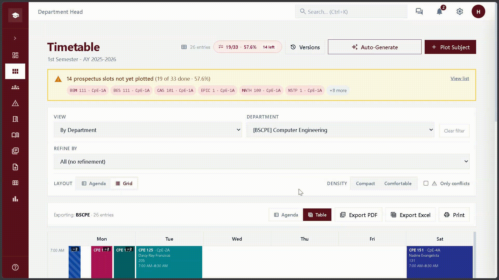

<div align="center">

<!-- CI & Status Badges -->


<br />

<!-- Tech Stack Badges -->


<br />

<h1>CoE-NNECT</h1>
<p><strong>College of Engineering Scheduling System</strong><br>
Western Mindanao State University</p>

</div>

CoE-NNECT is the academic scheduling system for the College of Engineering at Western Mindanao State University (WMSU). It combines academic data management, constraint-based schedule planning, role-based review and publication, live collaboration, reporting, and integration with the university's Institutional Data Platform (IDP).

## Table of contents

- [Tech stack](#tech-stack)
- [Project status](#project-status)
- [Capabilities](#capabilities)
- [Roles and access](#roles-and-access)
- [Architecture](#architecture)
- [Repository layout](#repository-layout)
- [Requirements](#requirements)
- [Get started](#get-started)
- [Common commands](#common-commands)
- [Testing](#testing)
- [Deployment](#deployment)
- [Documentation](#documentation)
- [Project information](#project-information)
- [Project team](#project-team)

## Tech stack

- **Monorepo:** pnpm workspaces
- **Backend:** NestJS, TypeORM, Supabase (PostgreSQL), Socket.IO, Swagger
- **Frontend:** React, Vite, Tailwind CSS, React Query, Zustand, React Router
- **Scheduling rules:** TypeScript package used by the API and as a post-solve validation gate
- **Solver:** Python FastAPI service using Google OR-Tools CP-SAT
- **PDF parser:** Python FastAPI service using pypdfium2, with optional Tesseract OCR
- **Deployment:** Railway — four services defined with Infrastructure as Code

## Project status

- **Constraint rules:** 27 registered rules with **194 passing tests**
- **CI/CD:** GitHub Actions covers backend build/type-check/tests, frontend lint/type-check/build, clean database migrations, and the Playwright scheduling workflow
- **Deployment:** Railway hosts the frontend, backend, solver, and parser; only the frontend is publicly exposed
- **Active development:** the application is feature-complete for its capstone scope, with ongoing hardening and documentation work

## Capabilities

Here is the automatic schedule generator in action:



- **Academic records:** manage departments, programs, terms, faculty, subjects, sections, rooms, and prospectuses.
- **Schedule planning:** plot, move, validate, review, finalize, and publish class schedules on a timetable grid.
- **Constraint validation:** detect faculty, room, section, workload, load-type, time, and laboratory conflicts with hard and soft rules.
- **Automatic generation:** build candidate schedules with the OR-Tools solver, then re-validate every generated block with the TypeScript rules engine before persisting a draft.
- **Approvals:** route department schedules through review and finalization, and coordinate cross-department faculty requests.
- **Reporting:** faculty workload, approval status, and room sufficiency reports, plus Excel/PDF exports where supported.
- **Collaboration:** role-scoped chat for deans and department heads, live online presence, persisted last-seen timestamps, notifications, and unread counts.
- **Prospectus import:** upload a PDF, define table and cell regions, extract selectable text, and resolve elective subjects and temporary codes.
- **IDP integration:** refresh faculty identity, qualifications, and unavailability from the Institutional Data Platform; exchange signed webhooks, schedules, faculty-request statuses, and change-request acknowledgements.
- **Administration:** user lifecycle, system settings, maintenance mode, audit trail, and a hidden developer tools surface for reset/seed operations.

## Roles and access

| Role | Workspace | Summary |
| --- | --- | --- |
| `college_dean` | `/dean/*` | College-wide oversight: approvals, reports, audit trail, user management, and all academic operations. |
| `college_secretary` | `/dean/*` | College-wide operational access. Shares the dean shell but has no approvals, audit trail, reports, timetable, or dev tools. |
| `department_head` | `/dashboard`, `/timetable`, ... | Department-scoped planning, faculty, subjects, sections, rooms, prospectus import, reports, and approvals. Blocked by the deactivated-department wall. |
| `viewer` | Department shell | Legacy read-oriented role retained for compatibility; it is not used by the current demo accounts. |
| `administrator` | `/dean/dev-tools` | Hidden developer-only account for reset, seed, and account maintenance. It is redirected away from all other dean pages and excluded from user-facing chat. |

Chat is available to `college_dean` and `department_head`. The `administrator` role can reach the service layer for maintenance but is filtered out of user-facing chat lists.

## Architecture

```text
Browser
  └── React + Vite frontend (apps/frontend)
        │  HTTP /api and Socket.IO /socket.io
        └── NestJS API (apps/backend)
              ├── Supabase Auth and PostgreSQL
              ├── TypeScript constraint rules (packages/constraint-rules)
              ├── FastAPI prospectus parser (packages/prospectus-parser)
              ├── FastAPI OR-Tools solver (packages/solver-service)
              └── Institutional Data Platform (IDP)
```

In production, Railway runs four services:

| Service | Source | Exposure |
| --- | --- | --- |
| `coe-nnectfrontend` | repo root; Vite build served by `apps/frontend/server.mjs` | Public |
| `coe-nnectbackend` | repo root; NestJS build | Private |
| `coe-nnectsolver` | `packages/solver-service` | Private |
| `coe-nnectparser` | `packages/prospectus-parser` | Private |

The browser talks only to the frontend origin. The Node server in `apps/frontend/server.mjs` serves the built SPA and proxies `/api` and `/socket.io` to the backend over Railway's private network, so the backend needs no public domain and the frontend needs no build-time backend URL.

Database schema changes are managed through the Supabase SQL workflow. TypeORM schema synchronization is disabled. See the [system architecture](docs/architecture/README.md) for component boundaries, data flows, and key workflows.

## Repository layout

```text
apps/
  backend/                 NestJS API
  frontend/                React + Vite web application
packages/
  constraint-rules/        TypeScript scheduling rules engine
  idp-client/              Reserved IDP client package (integration lives in the backend)
  prospectus-parser/       FastAPI PDF text extraction service
  shared-types/            Reserved shared TypeScript types package
  solver-service/          FastAPI OR-Tools scheduling service
docs/                      App, feature, package, operations, and database documentation
e2e/                       Playwright end-to-end scheduling workflow
supabase/                  Tracked migrations and database workflow
.railway/                  Railway Infrastructure as Code
```

`packages/idp-client` and `packages/shared-types` are placeholders. The working IDP integration lives in `apps/backend/src/modules/idp`, and the frontend and backend currently maintain their own transport types.

## Requirements

- Node.js 24 or newer
- pnpm 12.6.0 (the repository pins this version)
- Git
- A Supabase project and PostgreSQL database for database-backed features
- Python 3.11+ only for the optional parser and solver services
- Docker only for local Supabase and migration validation

## Get started

Clone the repository, install the JavaScript workspace dependencies, and create local environment files:

```powershell
git clone https://github.com/RADENzzz/coe-nnect.git
Set-Location coe-nnect
pnpm install
Copy-Item apps\backend\.env.example apps\backend\.env
Copy-Item apps\frontend\.env.example apps\frontend\.env.local
```

Configure the backend's Supabase credentials and PostgreSQL `DATABASE_URL`, then set the frontend's API and Supabase settings. Never commit real environment files or credentials. Values prefixed with `VITE_` are delivered to the browser and must not contain secrets.

Start the development system from the repository root:

```powershell
pnpm dev
```

The root development script starts the backend and frontend, plus the parser and solver when their Python virtual environments exist. It prints labelled service logs and shows the local URLs when startup completes. Press `Ctrl+C` to stop the services it started.

To install the Python dependencies and run all four services, run this one-time setup before starting the system:

```powershell
pnpm setup:venvs
pnpm dev
```

The setup command creates virtual environments under `packages\solver-service\.venv` and `packages\prospectus-parser\.venv` and installs each service's requirements. If those environments are absent, `pnpm dev` warns and skips the corresponding Python service while still starting the other available services.

By default, the frontend is at `http://localhost:5173`, the API is at `http://localhost:3000/api`, and the API docs are at `http://localhost:3000/api/docs`. The parser and solver use ports `8001` and `8000`, respectively. The backend requires a configured database; the development script does not start PostgreSQL or Supabase. Run backend commands from `apps/backend` when a command depends on its `.env` file.

To run only one service, use the root shortcuts: `pnpm dev:backend`, `pnpm dev:frontend`, `pnpm dev:parser`, or `pnpm dev:solver`. The `pnpm dev:no-parser` and `pnpm dev:no-solver` commands start the other services without the named service. See the [backend guide](docs/apps/backend.md) and [frontend guide](docs/apps/frontend.md) for configuration and checks.

To share the running app through a temporary public URL — for a demo or remote testing without deploying — install [cloudflared](https://developers.cloudflare.com/cloudflare-one/connections/connect-networks/downloads/), keep `pnpm dev` running, and in a second terminal run:

```powershell
pnpm online
```

It prints an `https://<random-words>.trycloudflare.com` link that anyone can open; `Ctrl+C` closes the public link while the local app keeps running. `pnpm dev:online` starts the app and the tunnel together in one terminal. The URL changes on every restart. The setup (same-origin API proxy, CORS, websocket/HMR handling), Supabase redirect requirements, and Cloudflare's request limits are covered in the [Cloudflare Tunnel guide](docs/operations/cloudflare-tunnel.md).

## Common commands

Run from the repository root:

| Command | Purpose |
| --- | --- |
| `pnpm dev` | Start the frontend, backend, and available Python services |
| `pnpm dev:no-solver` / `pnpm dev:no-parser` | Start the system without one Python service |
| `pnpm build` | Run available workspace build scripts |
| `pnpm test` | Run all workspace test scripts (backend Jest suites and constraint rules) |
| `pnpm lint` | Run available workspace lint scripts; backend lint applies fixes |
| `pnpm typecheck` | Run available workspace type checks |
| `pnpm --filter @coe-nnect/constraint-rules test` | Test the scheduling rules package (194 tests) |
| `pnpm --filter @coe-nnect/backend test` | Run backend unit tests |
| `pnpm --filter @coe-nnect/backend test:e2e` | Run backend integration tests with Supertest |
| `pnpm test:e2e` | Run the Playwright scheduling workflow (test project required) |
| `pnpm test:e2e:list` | Discover Playwright tests without starting servers |
| `pnpm typecheck:e2e` | Type-check the Playwright tests |
| `pnpm --filter @coe-nnect/frontend lint` | Lint the frontend |
| `pnpm online` | Temporary public Cloudflare link for the app already running |
| `pnpm dev:online` | Dev services plus the temporary public link, one terminal |
| `pnpm db:snapshot` | Regenerate the database DDL snapshot from `DATABASE_URL` |
| `pnpm --filter @coe-nnect/backend db:reset` | Hard-reset the configured database (destructive) |
| `pnpm --filter @coe-nnect/backend seed:demo` | Seed four departments and six demo accounts |
| `pnpm kill` | Stop listeners on ports 3000, 5173, 8000, and 8001 |

Review scripts and database targets before running them. Python services use the commands in their respective guides. The Dev Tools page runs the same reset and seed operations from the backend; in production it uses the compiled scripts and preserves the signed-in administrator during a reset.

## Testing

The repository uses several complementary test layers:

- **Constraint rules:** 27 rules and 194 unit tests in `packages/constraint-rules`.
- **Backend:** Jest unit tests plus Supertest integration tests under `apps/backend/test`, using fake Supabase adapters and no live database.
- **Database:** CI builds a clean Supabase database from every tracked migration and runs the empty `seed.sql`.
- **Browser E2E:** Playwright drives the department-head-to-dean scheduling workflow against a disposable Supabase project. Never point `E2E_*` variables at production.

The frontend has no unit or component test runner; it is covered by type-checking, linting, the production build, and Playwright. See the [testing guide](docs/testing.md) for commands, CI behavior, and the E2E seed model.

## Deployment

Railway deployment is defined in [`.railway/railway.ts`](.railway/railway.ts) and applied with the Railway CLI:

```bash
railway link
railway config plan
railway config apply
```

The IaC file creates the four services, private solver/parser URLs, build commands, health checks, and non-secret environment values. Secrets such as `DATABASE_URL`, Supabase keys, `CAP_SECRET`, and IDP credentials are entered in the Railway dashboard and preserved across applies. See the [Railway deployment guide](docs/operations/railway.md) for service details, manual variables, domains, and smoke tests.

## Documentation

- [Documentation index](docs/README.md) — start here for all guides.
- [Frontend guide](docs/apps/frontend.md) — routes, roles, features, environment, and checks.
- [Backend guide](docs/apps/backend.md) — modules, routes, auth, security, database scripts, and tests.
- [Chat and presence](docs/features/chat.md) — two-pane chat, Realtime presence, heartbeats, and notifications.
- [Dashboard](docs/features/dashboard.md) — department-head and dean dashboard content and data sources.
- [Elective subjects](docs/features/electives.md) — catalog model, elective PDF tables, and scheduling behavior.
- [System architecture](docs/architecture/README.md) — component map, data flows, and integration status.
- [Database structure](docs/DATABASE%20STRUCTURE/README.md) — ERDs, table inventory, enums, and constraints.
- [Testing](docs/testing.md) — unit, integration, migration, and browser test coverage.
- [Security policy](SECURITY.md) — supported versions, reporting, and implemented controls.
- [Accessibility statement](ACCESSIBILITY.md) — conformance target, supported assistive technology, and known limitations.
- [Contributing](CONTRIBUTING.md) — setup, branch, commit, and pull-request expectations.
- [Scheduling API contract](docs/interface-contract/docs/interface-contract/scheduling-api.md) — schedule routes and payload conventions.
- [Scheduling rules checklist](docs/reconciliation/scheduling-rules-checklist.md) — rule inventory and implementation links.

## Project information

| | |
| ------------------ | --------------------------------------------- |
| **Project** | CPE SD 3 — Management Information System |
| **Institution** | Western Mindanao State University |
| **College** | College of Engineering |
| **Academic year** | 2026–2027 |
| **Status** | Active development |
| **Project client** | Engr. Gajil J. Santos, College of Engineering |

## Project team

| Name | Project role |
| --- | --- |
| Jazmine Elaiza L. Luis | Project Manager |
| Alrhaden A. Javier | Lead Developer · System Architect |
| Giel V. Andales | Senior Developer |
| Edzel Don V. Tio | Junior Developer · Database Initialization |
| Roland C. Velez | Lead Tester · Assistant Trainer · Junior Archivist |
| Andre Aga B. Dacumos | Lead Trainer · Senior Tester |
| Aizzah Arabelle B. Javelosa | Lead Archivist · Assistant System Analyst |
| Euwan Tyrone B. Prias | Lead System Analyst · Senior Archivist |

---

Developed as part of the CPE SD 3 Management Information System project for the College of Engineering, Western Mindanao State University.
