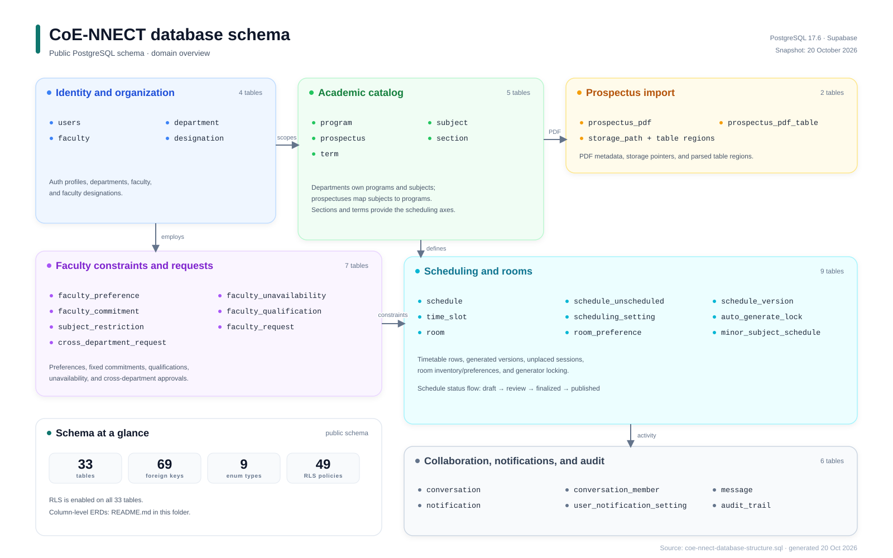
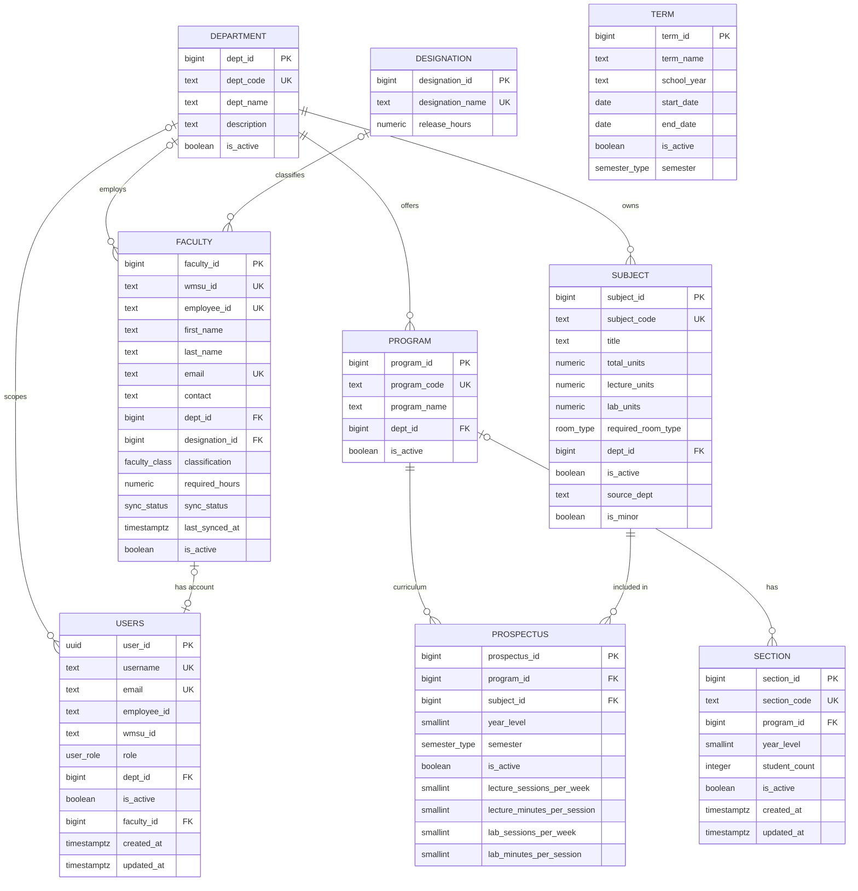
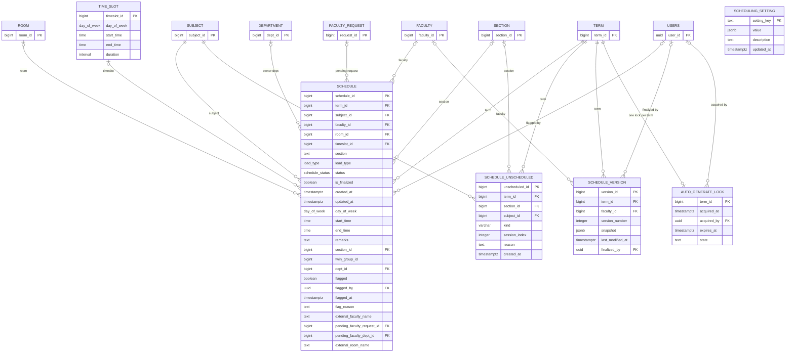
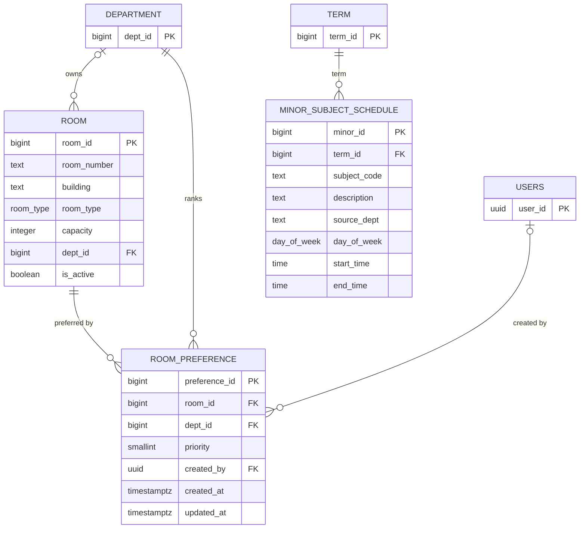
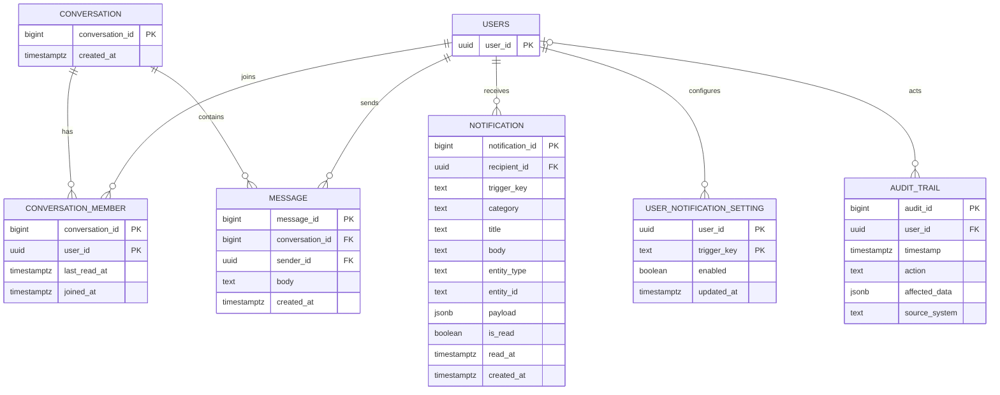
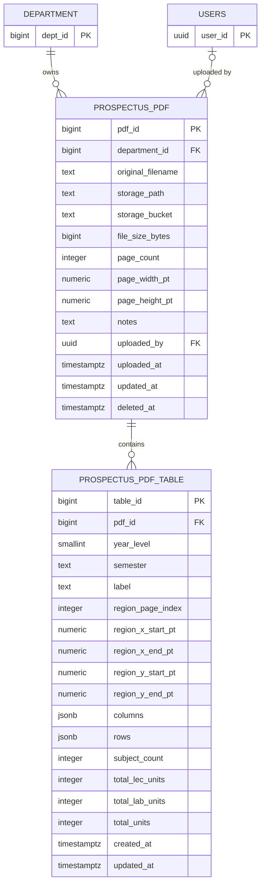

# Database structure

> **Snapshot:** [`coe-nnect-database-structure.sql`](coe-nnect-database-structure.sql) — generated 20 October 2026 from PostgreSQL 17.6 / Supabase. It contains the public schema only: tables, enum types, functions, triggers, indexes, RLS policies, and grants. It contains no row data.

**At a glance:** 33 tables · 69 foreign keys · 9 enum types · 65 explicit indexes · 49 RLS policies. Row-level security is enabled on all 33 tables.

CoE-NNECT uses PostgreSQL (Supabase) as its system of record. The NestJS API accesses it through TypeORM; the frontend uses Supabase Auth and Realtime. This page is the visual reference for the schema. The SQL snapshot remains the authoritative DDL.

> The diagrams below are split by domain. Shared entities appear as key-only stubs after the first diagram; their full columns are in the core diagram.

## Domain map

```mermaid
flowchart LR
    subgraph identity["Identity and organization"]
        direction TB
        users[users]
        department[department]
        faculty[faculty]
        designation[designation]
    end

    subgraph catalog["Academic catalog"]
        direction TB
        program[program]
        subject[subject]
        prospectus[prospectus]
        section[section]
        term[term]
    end

    subgraph requests["Faculty constraints and requests"]
        direction TB
        faculty_preference[faculty_preference]
        faculty_unavailability[faculty_unavailability]
        faculty_commitment[faculty_commitment]
        faculty_qualification[faculty_qualification]
        subject_restriction[subject_restriction]
        faculty_request[faculty_request]
        cross_department_request[cross_department_request]
    end

    subgraph scheduling["Scheduling and rooms"]
        direction TB
        schedule[schedule]
        schedule_unscheduled[schedule_unscheduled]
        schedule_version[schedule_version]
        time_slot[time_slot]
        scheduling_setting[scheduling_setting]
        auto_generate_lock[auto_generate_lock]
        room[room]
        room_preference[room_preference]
        minor_subject_schedule[minor_subject_schedule]
    end

    subgraph collaboration["Collaboration, notifications, and audit"]
        direction TB
        conversation[conversation]
        conversation_member[conversation_member]
        message[message]
        notification[notification]
        user_notification_setting[user_notification_setting]
        audit_trail[audit_trail]
    end

    subgraph pdf["Prospectus import"]
        direction TB
        prospectus_pdf[prospectus_pdf]
        prospectus_pdf_table[prospectus_pdf_table]
    end

    identity --> catalog
    identity --> requests
    catalog --> scheduling
    requests --> scheduling
    catalog --> pdf
    scheduling --> collaboration
```

## 1. Identity, organization, and academic catalog

`users` maps Supabase Auth identities to application profiles. Departments own programs, subjects, and faculty. Programs and subjects meet in `prospectus`; sections belong to programs; terms provide the time axis used later by scheduling.

Key constraints:

- `prospectus` is unique on `(program_id, subject_id, year_level, semester)`.
- `users.user_id` mirrors `auth.users.id`; the `on_auth_user_created` trigger creates the profile row.
- `users.faculty_id` is unique, so one faculty record can be linked to at most one application account.
- `faculty.email`, `faculty.employee_id`, `faculty.wmsu_id`, `program.program_code`, `subject.subject_code`, `section.section_code`, and `department.dept_code` are unique where present.

## 2. Faculty constraints, qualifications, and requests

These tables describe what faculty can teach, when they are unavailable, and how departments request faculty or subjects across department boundaries. `faculty_request` is the typed request/approval workflow; `cross_department_request` is a second request shape that adds a specific `timeslot_id` and uses a free-text status.

```mermaid
erDiagram
    FACULTY ||--o{ FACULTY_PREFERENCE : "prefers"
    FACULTY ||--o{ FACULTY_UNAVAILABILITY : "unavailable"
    TERM |o--o{ FACULTY_UNAVAILABILITY : "applies to"
    FACULTY ||--o{ FACULTY_COMMITMENT : "committed"
    TERM |o--o{ FACULTY_COMMITMENT : "applies to"
    FACULTY ||--o{ FACULTY_QUALIFICATION : "qualified for"
    SUBJECT ||--o{ FACULTY_QUALIFICATION : "requires"
    SUBJECT ||--o{ SUBJECT_RESTRICTION : "subject A"
    SUBJECT ||--o{ SUBJECT_RESTRICTION : "subject B"
    TERM |o--o{ SUBJECT_RESTRICTION : "applies to"
    DEPARTMENT ||--o{ FACULTY_REQUEST : "requesting dept"
    DEPARTMENT ||--o{ FACULTY_REQUEST : "target dept"
    FACULTY |o--o{ FACULTY_REQUEST : "requested faculty"
    SUBJECT ||--o{ FACULTY_REQUEST : "requested subject"
    TERM ||--o{ FACULTY_REQUEST : "term"
    USERS |o--o{ FACULTY_REQUEST : "created by"
    USERS |o--o{ FACULTY_REQUEST : "responded by"
    DEPARTMENT ||--o{ CROSS_DEPARTMENT_REQUEST : "requesting dept"
    DEPARTMENT ||--o{ CROSS_DEPARTMENT_REQUEST : "target dept"
    FACULTY |o--o{ CROSS_DEPARTMENT_REQUEST : "faculty"
    SUBJECT |o--o{ CROSS_DEPARTMENT_REQUEST : "subject"
    TERM |o--o{ CROSS_DEPARTMENT_REQUEST : "term"
    TIME_SLOT |o--o{ CROSS_DEPARTMENT_REQUEST : "timeslot"
    USERS |o--o{ CROSS_DEPARTMENT_REQUEST : "requested by"
    USERS |o--o{ CROSS_DEPARTMENT_REQUEST : "approved by"

    FACULTY {
        bigint faculty_id PK
    }
    SUBJECT {
        bigint subject_id PK
    }
    TERM {
        bigint term_id PK
    }
    DEPARTMENT {
        bigint dept_id PK
    }
    USERS {
        uuid user_id PK
    }
    TIME_SLOT {
        bigint timeslot_id PK
    }
    FACULTY_PREFERENCE {
        bigint preference_id PK
        bigint faculty_id FK
        day_of_week preferred_day
        time preferred_start_time
        time preferred_end_time
    }
    FACULTY_UNAVAILABILITY {
        bigint unavailability_id PK
        bigint faculty_id FK
        bigint term_id FK
        text day_of_week
        time start_time
        time end_time
        text reason
        text source
        text external_id
        timestamptz synced_at
        timestamptz created_at
    }
    FACULTY_COMMITMENT {
        bigint commitment_id PK
        bigint faculty_id FK
        bigint term_id FK
        day_of_week day_of_week
        time start_time
        time end_time
        text title
        text source_system
        text external_id
        timestamptz last_synced_at
    }
    FACULTY_QUALIFICATION {
        bigint qual_id PK
        bigint faculty_id FK
        bigint subject_id FK
        text source_system
    }
    SUBJECT_RESTRICTION {
        bigint restriction_id PK
        bigint subject_id_1 FK
        bigint subject_id_2 FK
        bigint term_id FK
        text warning_message
        boolean is_active
        uuid created_by FK
        timestamptz created_at
    }
    FACULTY_REQUEST {
        bigint request_id PK
        bigint requesting_dept_id FK
        bigint target_dept_id FK
        bigint faculty_id FK
        bigint subject_id FK
        bigint term_id FK
        text reason
        faculty_request_status status
        uuid created_by FK
        timestamptz created_at
        uuid responded_by FK
        timestamptz responded_at
        text response_remarks
        timestamptz updated_at
    }
    CROSS_DEPARTMENT_REQUEST {
        uuid request_id PK
        bigint requesting_dept_id FK
        bigint target_dept_id FK
        bigint faculty_id FK
        bigint subject_id FK
        bigint term_id FK
        bigint timeslot_id FK
        text reason
        varchar status
        uuid requested_by FK
        uuid approved_by FK
        timestamptz resolved_at
        text remarks
        timestamptz created_at
    }
```

Key constraints and behavior:

- `faculty_qualification` is unique on `(faculty_id, subject_id)`.
- `faculty_commitment` is unique on `(source_system, external_id)`.
- `faculty_unavailability` has a partial unique index on `(faculty_id, external_id)` when `external_id` is present.
- `faculty_request` enforces `requesting_dept_id <> target_dept_id` and uses `faculty_request_status`: `pending`, `approved`, `rejected`, `cancelled`.
- `subject_restriction` enforces `subject_id_1 <> subject_id_2`.
- `faculty_unavailability.source` is `local` or `idp`; `faculty_commitment` is the fixed external commitment feed.
- `cross_department_request.status` is free text with a default of `pending`, not the `faculty_request_status` enum.

## 3. Scheduling core

`schedule` is the operational timetable row. It keeps normalized foreign keys for term, subject, faculty, room, timeslot, and section, but also stores snapshot fields (`section`, `day_of_week`, `start_time`, `end_time`, external faculty/room names) so imported or historical rows remain readable if referenced data changes. `schedule_version` stores JSON snapshots of generated timetable versions. `schedule_unscheduled` records sessions that the solver could not place. `auto_generate_lock` serializes generator runs per term.

Key constraints and behavior:

- `schedule.status` follows `draft`, `review`, `finalized`, `published`; the `trg_schedule_status_flow` trigger rejects transitions outside the allowed flow.
- `schedule.is_finalized` is a generated column: true for `finalized` and `published`.
- Partial unique indexes prevent the same faculty member or room from being booked twice in the same term/timeslot:
  - `(term_id, faculty_id, timeslot_id)` where both keys are present
  - `(term_id, room_id, timeslot_id)` where both keys are present
- `schedule_version` is unique on `(term_id, faculty_id, version_number)` and has a term-wide uniqueness rule when `faculty_id` is null.
- `auto_generate_lock.term_id` is both the primary key and a foreign key to `term`, so there is at most one lock row per term. `state` is `running` or `pending_confirm`.
- `scheduling_setting` is a key/value store for global scheduling configuration.
- `schedule` uses `section` (text) and `section_id` (FK) together; the text value is the historical/imported snapshot.

## 4. Rooms, preferences, and minor subjects

Rooms belong to a department and can be ranked by other departments through `room_preference`. A trigger prevents a department from creating a preference for a room it already owns. `minor_subject_schedule` is an auxiliary timetable for minor subjects; it stores `subject_code` as text rather than linking to `subject`.

Key constraints:

- `room` is unique on `(building, room_number)`.
- `room_preference` is unique on `(room_id, dept_id)` and `priority` is constrained to 1–3.
- `room_preference` has a trigger that rejects preferences for rooms with an owning department; those rooms are exclusive to their department.
- `minor_subject_schedule` has no FK to `subject`; it is intentionally a separate imported/auxiliary record.

## 5. Collaboration, notifications, and audit

Chat is modelled as conversations with explicit membership. Notifications are per-user records with a polymorphic `entity_type`/`entity_id` reference and a JSON payload. Notification preferences are stored per user and trigger. `audit_trail` is an append-oriented event log keyed by the acting user.

Key constraints and behavior:

- `conversation_member` uses the composite primary key `(conversation_id, user_id)`.
- `user_notification_setting` uses the composite primary key `(user_id, trigger_key)`.
- `message.body` is constrained to 1–2000 characters.
- `conversation` has no name or type column; a conversation is defined by its membership and messages.
- `notification` and `audit_trail` use polymorphic/JSON data rather than foreign keys to every possible target entity.

## 6. Prospectus PDF import

Uploaded prospectus PDFs are stored in Supabase Storage; the database keeps the object path and page geometry. `prospectus_pdf_table` stores user-defined table regions and extracted JSON rows/columns.

Key constraints and behavior:

- `prospectus_pdf.storage_bucket` defaults to `prospectus-pdfs`; the bucket itself is created in Supabase Storage, not by the SQL snapshot.
- `prospectus_pdf.deleted_at` provides soft deletion. The repository uses `deleted_at IS NULL` for active PDF queries.
- `prospectus_pdf_table` is unique on `(pdf_id, year_level, semester)` and is cascade-deleted with its parent PDF.
- `prospectus_pdf_table.columns` and `.rows` hold the parsed table structure as JSONB; the remaining numeric fields are copied totals for quick display.

## Table inventory

| Table | Primary key | Purpose |
|---|---|---|
| `audit_trail` | `audit_id` | Append-oriented audit events with actor, action, JSON data, and source system. |
| `auto_generate_lock` | `term_id` | One row per term used to serialize auto-generation runs. |
| `conversation` | `conversation_id` | Chat thread header. |
| `conversation_member` | `(conversation_id, user_id)` | Conversation membership and last-read marker. |
| `cross_department_request` | `request_id` (UUID) | Cross-department request with a specific timeslot and free-text status. |
| `department` | `dept_id` | Academic department. |
| `designation` | `designation_id` | Faculty designation and release hours. |
| `faculty` | `faculty_id` | Faculty profile, department, designation, and sync state. |
| `faculty_commitment` | `commitment_id` | Fixed external commitments that block availability. |
| `faculty_preference` | `preference_id` | Preferred teaching day and time window. |
| `faculty_qualification` | `qual_id` | Faculty-to-subject qualification mapping. |
| `faculty_request` | `request_id` | Typed cross-department faculty request and approval workflow. |
| `faculty_unavailability` | `unavailability_id` | Local or IDP-sourced unavailable time blocks. |
| `message` | `message_id` | Chat message body and sender. |
| `minor_subject_schedule` | `minor_id` | Auxiliary timetable for minor subjects. |
| `notification` | `notification_id` | Per-user notification with read state and JSON payload. |
| `program` | `program_id` | Degree program offered by a department. |
| `prospectus` | `prospectus_id` | Program/subject curriculum mapping with year, semester, and session durations. |
| `prospectus_pdf` | `pdf_id` | Uploaded prospectus PDF metadata and storage pointer. |
| `prospectus_pdf_table` | `table_id` | User-defined table region and parsed rows inside a PDF. |
| `room` | `room_id` | Room inventory and owning department. |
| `room_preference` | `preference_id` | Department priority for a shared room. |
| `schedule` | `schedule_id` | Scheduled class/session row. |
| `schedule_unscheduled` | `unscheduled_id` | Sessions the generator could not place. |
| `schedule_version` | `version_id` | JSON snapshot of a generated schedule version. |
| `scheduling_setting` | `setting_key` | Global scheduling configuration key/value. |
| `section` | `section_id` | Student section/cohort within a program. |
| `subject` | `subject_id` | Course catalog entry. |
| `subject_restriction` | `restriction_id` | Pairwise subject restriction with an optional term. |
| `term` | `term_id` | Academic term with school year, dates, and semester. |
| `time_slot` | `timeslot_id` | Reusable day/start/end slot with generated duration. |
| `user_notification_setting` | `(user_id, trigger_key)` | Per-user notification opt-in. |
| `users` | `user_id` | Application profile linked to a Supabase Auth user. |

## Enum types

| Enum | Values |
|---|---|
| `day_of_week` | `Monday`, `Tuesday`, `Wednesday`, `Thursday`, `Friday`, `Saturday`, `Sunday` |
| `faculty_class` | `regular`, `part_time`, `visiting_lecturer`, `other` |
| `faculty_request_status` | `pending`, `approved`, `rejected`, `cancelled` |
| `load_type` | `lecture`, `laboratory`, `other` |
| `room_type` | `lecture_room`, `laboratory`, `computer_lab`, `drafting_room`, `other`, `any` |
| `schedule_status` | `draft`, `review`, `finalized`, `published` |
| `semester_type` | `1st`, `2nd`, `summer` |
| `sync_status` | `pending`, `synced`, `failed` |
| `user_role` | `administrator`, `college_dean`, `department_head`, `viewer` |

## Important database behavior

### Identity and auth

- `users.user_id` is the Supabase Auth user ID (UUID). The `on_auth_user_created` trigger inserts a matching `public.users` row from the auth metadata, defaulting unknown roles to `viewer`.
- The API verifies Supabase access tokens, then loads the application profile for role checks. The frontend also reads its own profile and uses Supabase Realtime for presence/chat; those direct anon-key requests are subject to RLS. Privileged writes go through the NestJS API.

### Row-level security

- RLS is enabled on all 33 tables.
- There are 49 policies. They use `auth.uid()`, `public.current_user_role()`, and `public.current_user_dept()` for ownership and role checks.
- The backend connects through the trusted PostgreSQL role and applies application-level guards. RLS is the boundary for direct Supabase client access.

### Generated and derived values

- `schedule.is_finalized` is generated from `schedule.status`.
- `time_slot.duration` is generated from `end_time - start_time`.
- `updated_at` columns are maintained by `set_updated_at()` or `touch_updated_at()` triggers where present.

### Schedule integrity

- The schedule status trigger allows:
  - `draft → review`
  - `review → draft`
  - `review → finalized`
  - `finalized → review`
  - `finalized → published`
  - `published → finalized`
  - `draft → finalized`
  - `finalized → draft`
- Other status transitions are rejected.
- Partial unique indexes enforce one faculty booking and one room booking per term/timeslot.
- `schedule` retains both normalized IDs and snapshot values for imported/historical rows.

### JSONB fields

| Table | Columns |
|---|---|
| `audit_trail` | `affected_data` |
| `notification` | `payload` |
| `prospectus_pdf_table` | `columns`, `rows` |
| `schedule_version` | `snapshot` |
| `scheduling_setting` | `value` |

### Schema workflow

- TypeORM synchronization is disabled (`synchronize: false`).
- Schema changes are applied through the Supabase SQL workflow and captured in `coe-nnect-database-structure.sql`.
- The SQL file contains the public schema only; the `on_auth_user_created` trigger on `auth.users` is appended separately because a public-only `pg_dump` does not include it.
- When the schema changes, regenerate the snapshot and update the diagrams/counts on this page.
