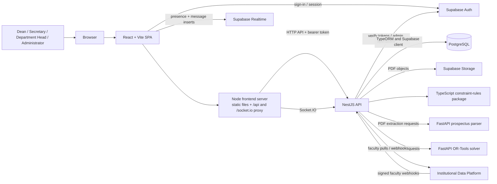
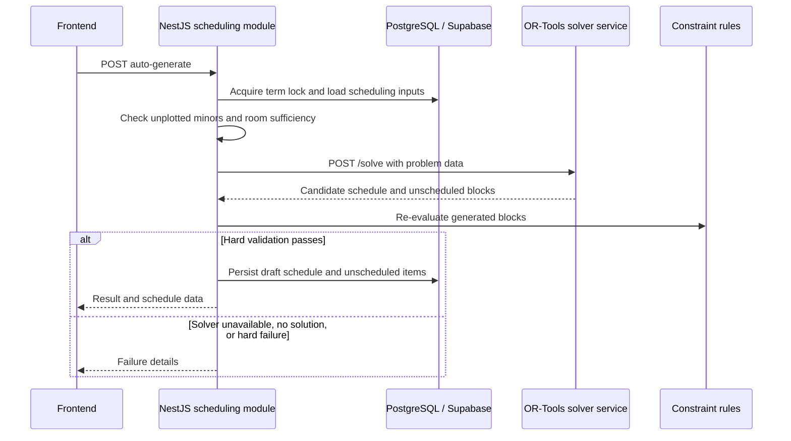

# CoE-NNECT system architecture

This document describes the architecture implemented in this repository. It is a system-level map; service setup, endpoint payloads, and rule-by-rule behavior remain in their more detailed guides linked below.

## System context

CoE-NNECT is a browser-based academic scheduling system for the WMSU College of Engineering. The main application is a React single-page app served by a small Node server and backed by a NestJS API. PostgreSQL and Supabase provide persistence, authentication, Realtime, and object storage. Two separately deployed Python services provide prospectus PDF extraction and schedule optimization. The backend also integrates with the university's Institutional Data Platform (IDP).

The parser and solver are separate processes and communicate with the backend over HTTP. They are not imported into the browser or run in the NestJS process. The solver is part of the active auto-generation flow: the backend calls it using `SOLVER_URL` (default `http://localhost:8000`).

## Runtime components

| Component | Responsibility | Implementation |
| --- | --- | --- |
| Web application | Role-specific screens for academic data, schedule planning, approvals, reports, notifications, chat, settings, and PDF import | `apps/frontend` — React, TypeScript, Vite |
| Frontend server | Serves the built SPA, proxies `/api` and `/socket.io` to the backend, and falls back to `index.html` for client routes | `apps/frontend/server.mjs` — Node |
| API | Authentication/profile lookup, role-protected routes, domain operations, validation, persistence coordination, and service orchestration | `apps/backend` — NestJS |
| Authentication | Email/password sign-in and access/refresh tokens; backend verifies bearer tokens and looks up application profiles | Supabase Auth + Cap CAPTCHA |
| Relational data | Academic and application entities including schedules, faculty, rooms, users, terms, approvals, audit records, chat, presence, and notifications | PostgreSQL accessed through TypeORM and selected Supabase client queries |
| Realtime | Live online presence and chat message inserts for the open conversation | Supabase Realtime |
| File storage | Uploaded prospectus PDFs and signed download URLs | Supabase Storage bucket `prospectus-pdfs` |
| Constraint rules | Deterministic hard/soft rule evaluation for manual schedule validation and generated-schedule checks | `packages/constraint-rules` |
| PDF parser | Reads selectable PDF text within client-defined table/cell regions; optional OCR for scans | `packages/prospectus-parser` — FastAPI |
| Schedule solver | Builds candidate schedules from academic inputs using OR-Tools CP-SAT | `packages/solver-service` — FastAPI |
| IDP integration | Pulls faculty identity, qualifications, and unavailability; receives signed faculty-change and change-request webhooks; publishes schedules and request statuses | `apps/backend/src/modules/idp` — NestJS module |

The root pnpm workspace contains both applications and the packages above. `packages/idp-client` is reserved and is not the implementation of the IDP integration: the integration lives in the backend `IdpModule`. `packages/shared-types` is also not an active shared contract: frontend and backend currently maintain their own types.

## Application structure

### Frontend

The browser entry point in `apps/frontend/src/main.tsx` installs React Query, React Router, the auth provider, and global styles. Route trees and role restrictions are assembled in `apps/frontend/src/App.tsx`; feature screens live under `src/features`, reusable UI and layouts under `src/components`, and HTTP clients under `src/api`. `PresenceProvider` mounts above the router so the Supabase presence channel and the last-seen heartbeat stay active for the whole signed-in session.

The Axios API client obtains the current Supabase session and attaches its access token to API requests. A `401` response signs out the browser session and redirects to login. React Query is used for server state; Zustand stores client-side auth, theme, and UI state.

The application has two shells:

- **Department shell** (`AppShell`) for `department_head` and the legacy `viewer` role.
- **Dean shell** (`DeanShell`) for `college_dean`, `college_secretary`, and the hidden `administrator`.

`college_secretary` shares the dean shell and most college-wide operational pages, but its navigation omits approvals, audit trail, reports, the read-only timetable, and dev tools. The `administrator` role is redirected to `/dean/dev-tools` from every other dean route. These browser guards shape navigation and user experience; API guards enforce authorization on protected server routes.

### Backend

`apps/backend/src/main.ts` creates the Nest application, configures the global API prefix (default `/api`), CORS, Helmet/CSP, DTO validation, Socket.IO, Swagger/OpenAPI, raw request bodies for IDP HMAC verification, structured request logging, and global/login/Cap rate limiters. `AppModule` composes the feature modules and installs a global audit interceptor.

Backend feature modules follow the Nest module/controller/service pattern:

- Controllers expose HTTP endpoints and apply authentication, role, and audit decorators.
- Services contain domain operations and coordinate repositories, Supabase, rules, or external services.
- DTOs validate request shapes; entities map selected PostgreSQL tables through TypeORM.
- Shared guards and audit components are under `src/common`.

The main feature areas include identity and users; departments, programs, and terms; faculty and qualifications/preferences/unavailability; subjects, prospectuses, and sections; rooms; scheduling and constraints; approvals; system configuration and status; prospectus PDF import; notifications; chat; presence; search; reports/statistics; audit history; and the IDP integration.

## Identity, authorization, and persistence

1. The frontend obtains a Cap challenge and solves it in the login widget.
2. The backend redeems the solution for a short-lived, single-use login token.
3. `POST /api/v1/auth/login` verifies that token, then signs in through Supabase Auth.
4. The backend finds the corresponding application `User` profile in PostgreSQL and returns profile/role data with the tokens.
5. For API requests, the frontend sends the Supabase access token as a bearer token.
6. `JwtAuthGuard` verifies the token with Supabase Auth. Where a route declares required roles, `RolesGuard` loads the active application profile and checks its role.

Application roles are `college_dean`, `college_secretary`, `department_head`, `viewer`, and `administrator`. `administrator` is a hidden developer account rather than a general persona; it is restricted to Dev Tools and excluded from user-facing chat. `viewer` is a legacy read-oriented role retained for compatibility.

Cap is fail-closed: `CAP_SECRET` must be configured and at least 16 bytes, challenges and redeem tokens expire after 10 minutes, and `cap_nonce` / `cap_token` make redemption single-use. Both Cap tables enable RLS and revoke access from `anon` and `authenticated`.

Backend services access relational records using TypeORM repositories. Some operations use the Supabase JS client directly, including Supabase Auth and the scheduling rule-context loader. PDF objects are handled by the Supabase Storage client. The application therefore uses both TypeORM and Supabase client APIs; PostgreSQL is the relational data store, not a TypeORM-managed schema. TypeORM schema synchronization is disabled. Schema changes are managed through the Supabase SQL workflow.

## Key workflows

### Schedule planning and validation

For a manual plot, the API receives a candidate schedule block and builds a rule context from the subject, faculty, room, section, existing schedule, faculty commitments, minor blocks, restrictions, approved requests, and scheduling settings. `ConstraintsService` evaluates the registered rules from `@coe-nnect/constraint-rules`; the API returns hard conflicts and soft warnings for the UI to present. The scheduling service also has backend-level checks for conditions that are not represented by package rules.

The rule package currently registers 27 rules. A hard failure makes an evaluation invalid; a soft warning does not. The rule inventory and the schedule endpoint contract are maintained separately; see the [constraint rules guide](../packages/constraint-rules.md), [rules checklist](../reconciliation/scheduling-rules-checklist.md), and [scheduling API contract](../interface-contract/docs/interface-contract/scheduling-api.md).

### Automatic schedule generation

The backend prevents concurrent generation for the same term using an in-process check and a database lock. It prepares solver inputs, checks room sufficiency, calls the solver, validates returned assignments with the TypeScript rules engine, and only then persists the draft. The backend also dispatches progress/failure notifications. The solver endpoint is `POST /solve`; `GET /health` is available for health checks. The backend client uses a **240-second** solve timeout and retries transient `502`/`503`/`504`/network failures. See the [solver service guide](../packages/solver-service.md).

### Prospectus PDF import

1. An authorized user uploads a PDF through the frontend editor.
2. The backend stores the file in Supabase Storage and persists PDF/table-region metadata in PostgreSQL.
3. `/info` supplies page dimensions. `/detect` can propose table geometry and row bands, which the user reviews and edits.
4. The backend retrieves the PDF and sends its base64 contents plus the region specifications to the parser's `/extract` endpoint.
5. The parser returns cell text. The user reviews the extraction and confirms the import; the backend creates or matches subjects and writes prospectus entries.

Image-only pages can use the parser's opt-in OCR fallback. This is text extraction from PDF content within defined regions plus optional Tesseract OCR, not a general document-understanding pipeline. Backend timeouts are 60 seconds for `/info` and normal `/extract`, 240 seconds for OCR extraction, 180 seconds for `/detect`, and 30 seconds for health checks. See the [prospectus parser guide](../packages/prospectus-parser.md).

### Chat, presence, and notifications

Chat is a private, direct-message surface for `college_dean` and `department_head`. Conversations and messages are stored in PostgreSQL; `conversation_member.last_read_at` drives unread counts. New messages are pushed to other members over Socket.IO (`chat:new`) and published to Supabase Realtime for the open conversation's `public.message` inserts.

Presence has two layers:

- Supabase Realtime channel `presence:online-users` tracks who is connected right now.
- `POST /api/v1/users/me/heartbeat` writes `user_presence.last_seen_at` every 60 seconds while the tab is visible, so the UI can show a last-seen label when the live dot is off.

Notifications are persisted for inbox/history access. The notifications module dispatches configured trigger events, while the Socket.IO gateway verifies a Supabase token at connection time and joins the socket to a private `user:<id>` room for `notification:new`, `unread_count`, and `chat:new` events. The cron scheduler is enabled for notification retention work. See [Chat and presence](../features/chat.md).

### IDP integration

The IDP integration implements Milestones 1 and 3 of the CoE-NNECT ↔ IDP v2.0 contract. The `IdpModule` exposes a public `/api/idp/v1/*` namespace for health, signed faculty-change and change-request webhooks, the Pattern C faculty inbox, and the schedule / faculty-request / change-request-ack outboxes. It also exposes authenticated `POST /api/v1/idp/faculty/sync`, `POST /api/v1/idp/schedules/publish`, and the change-request review/ack routes. Pattern A pulls the roster, qualifications, and unavailability from IDP, matches faculty by `wmsu_id` then `employee_id`, applies IDP-owned identity fields, and maintains `faculty.sync_status` / `last_synced_at`. Inbound webhooks are verified with HMAC-SHA256 over the raw body and a timestamp tolerance. Local identity edits mark a row pending, which blocks incoming IDP updates with `409 local_edit_pending` until reconciled. Pattern C is primary because the IDP desktop can be offline: schedules, faculty-request statuses, and change-request acks are kept in a durable outbox until the client polls. See the [IDP integration guide](../integrations/idp.md).

## Deployment and local development

Production runs on **Railway** as four services defined in [`.railway/railway.ts`](../../.railway/railway.ts):

| Service | Source | Exposure | Health check |
| --- | --- | --- | --- |
| `coe-nnectfrontend` | repo root; Vite build + `apps/frontend/server.mjs` | Public | `/` |
| `coe-nnectbackend` | repo root; NestJS build | Private | `/api/v1/health` |
| `coe-nnectsolver` | `packages/solver-service` | Private | `/health` |
| `coe-nnectparser` | `packages/prospectus-parser` | Private | `/health` |

The browser talks only to the frontend origin. The frontend Node server proxies `/api` and `/socket.io` to the backend over Railway's private network, so the backend needs no public domain and the frontend needs no build-time backend URL. The backend reaches the solver and parser through Railway reference variables. Supabase remains an external managed dependency for PostgreSQL, Auth, Storage, and Realtime.

Local defaults used by the development script are:

| Service | Default URL / port |
| --- | --- |
| Frontend | `http://localhost:5173` |
| NestJS API | `http://localhost:3000/api` |
| Solver | `http://localhost:8000` |
| Prospectus parser | `http://localhost:8001` |

`pnpm dev` starts the web applications and starts Python services when their virtual environments are available. Individual services can also be started separately. A missing parser affects PDF extraction; a missing solver affects automatic schedule generation, but does not prevent the rest of the API from starting. See the [backend guide](../apps/backend.md), [frontend guide](../apps/frontend.md), [Railway deployment guide](../operations/railway.md), and root [development instructions](../../README.md#get-started).

## Architectural boundaries and current status

- **Active synchronous paths:** Browser → frontend server → NestJS API; backend → PostgreSQL/Supabase; backend → parser for PDF extraction; backend → solver for auto-generation; backend → IDP for faculty pulls; IDP → backend for signed webhooks.
- **Active realtime paths:** Browser ↔ Supabase Realtime for presence and open-conversation message inserts; backend → browser over Socket.IO for notifications and chat pushes.
- **Validation source:** TypeScript constraints are used by API schedule validation and as a post-solve validation gate. The solver's optimization constraints and objectives are implemented separately in Python.
- **No shared TS contract package:** The `shared-types` workspace package is not currently the source of frontend/backend API contracts.
- **Authentication:** Supabase Auth plus Cap CAPTCHA. Cap is required for login and fails closed when `CAP_SECRET` is missing or too short.
- **Chat and presence:** direct dean/head chat, unread markers, Socket.IO chat pushes, Supabase Realtime presence, and persisted last-seen heartbeats are implemented.
- **IDP integration:** Milestones 1 and 3 (faculty roster, qualifications, unavailability, signed faculty webhooks, the user-triggered refresh, schedule publishing, faculty-request status publishing, change requests, and change-request acknowledgements) are implemented in `apps/backend/src/modules/idp`. The admin settings UI remains Milestone 4. The `packages/idp-client` package remains a placeholder.
- **Schema ownership:** SQL/Supabase workflows own the database schema; TypeORM synchronization must remain disabled.

## Further documentation

- [Backend API guide](../apps/backend.md)
- [Frontend guide](../apps/frontend.md)
- [Chat and presence](../features/chat.md)
- [Dashboard](../features/dashboard.md)
- [IDP integration](../integrations/idp.md)
- [Constraint rules](../packages/constraint-rules.md)
- [Solver service](../packages/solver-service.md)
- [Prospectus parser](../packages/prospectus-parser.md)
- [Shared types status](../packages/shared-types.md)
- [IDP client package status](../packages/idp-client.md)
- [Railway deployment](../operations/railway.md)
- [Documentation index](../README.md)
