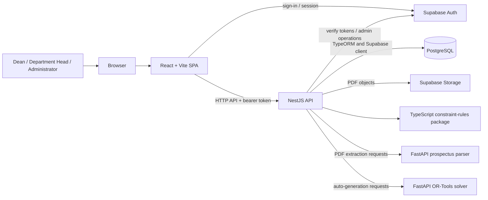
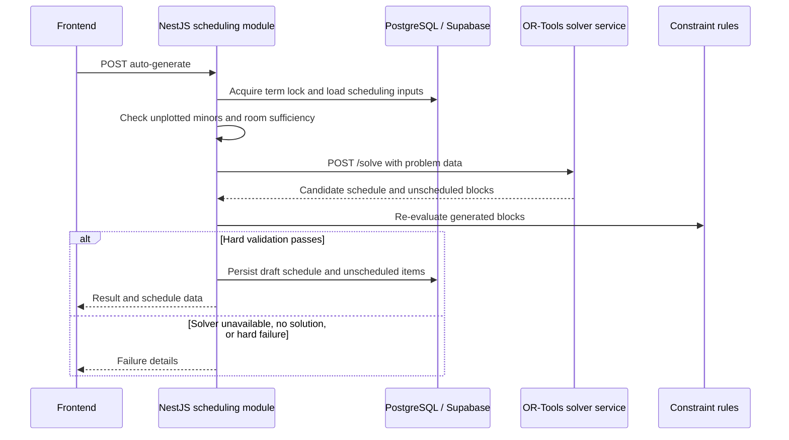

# CoE-NNECT system architecture

This document describes the architecture implemented in this repository. It is intended as a system-level map; service setup, endpoint payloads, and rule-by-rule behavior remain in their more detailed guides linked below.

## System context

CoE-NNECT is a browser-based academic scheduling system for the WMSU College of Engineering. The main application is a React SPA backed by a NestJS API. PostgreSQL and Supabase provide persistence, authentication, and object storage. Two separately hosted Python services provide PDF text extraction and schedule optimization.

The parser and solver are separate processes and communicate with the backend over HTTP. They are not imported into the browser or run in the NestJS process. The solver is nevertheless part of the active auto-generation flow: the backend calls it using `SOLVER_URL` (default `http://localhost:8000`).

## Runtime components

| Component | Responsibility | Implementation |
| --- | --- | --- |
| Web application | Role-specific screens for academic data, schedule planning, approvals, reports, notifications, settings, and PDF import | `apps/frontend` — React, TypeScript, Vite |
| API | Authentication/profile lookup, role-protected routes, domain operations, validation, persistence coordination, and service orchestration | `apps/backend` — NestJS |
| Authentication | Email/password sign-in and access/refresh tokens; backend verifies bearer tokens and looks up application profiles | Supabase Auth |
| Relational data | Academic and application entities including schedules, faculty, rooms, users, terms, approvals, audit records, chat, and notifications | PostgreSQL accessed through TypeORM and selected Supabase client queries |
| File storage | Uploaded prospectus PDFs and signed download URLs | Supabase Storage bucket `prospectus-pdfs` |
| Constraint rules | Deterministic hard/soft rule evaluation for manual schedule validation and generated-schedule checks | `packages/constraint-rules` |
| PDF parser | Reads selectable PDF text within client-defined table/cell regions | `packages/prospectus-parser` — FastAPI |
| Schedule solver | Builds candidate schedules from academic inputs using OR-Tools CP-SAT | `packages/solver-service` — FastAPI |

The root pnpm workspace contains both applications and the packages above. `packages/idp-client` is reserved and not integrated. `packages/shared-types` is also not an active shared contract: frontend and backend currently maintain their own types.

## Application structure

### Frontend

The browser entry point in `apps/frontend/src/main.tsx` installs React Query, React Router, and the auth provider. Route trees and role restrictions are assembled in `apps/frontend/src/App.tsx`; feature screens live under `src/features`, reusable UI and layouts under `src/components`, and HTTP clients under `src/api`.

The Axios API client obtains the current Supabase session and attaches its access token to API requests. A `401` response signs out the browser session and redirects to login. React Query is used for server state; Zustand stores client-side auth and UI state.

The Dean workspace serves `college_dean` users and also routes the hidden `administrator` role, which is constrained to developer tools by an additional route guard. The main workspace is restricted to `department_head`. These browser guards shape navigation and user experience; API guards enforce authorization on protected server routes.

### Backend

`apps/backend/src/main.ts` creates the Nest application, configures the global API prefix (default `/api`), CORS, Helmet, DTO validation, Socket.IO, and Swagger/OpenAPI. `AppModule` composes the feature modules and installs a global audit interceptor.

Backend feature modules follow the Nest module/controller/service pattern:

- Controllers expose HTTP endpoints and apply authentication, role, and audit decorators.
- Services contain domain operations and coordinate repositories, Supabase, rules, or external services.
- DTOs validate request shapes; entities map selected PostgreSQL tables through TypeORM.
- Shared guards and audit components are under `src/common`.

The main feature areas include identity and users; departments, programs and terms; faculty and qualifications/preferences/unavailability; subjects, prospectuses and sections; rooms; scheduling and constraints; approvals; system configuration; prospectus PDF import; notifications; chat; search; reports/statistics; and audit history.

## Identity, authorization, and persistence

1. The frontend signs in through the backend auth API, which uses Supabase Auth.
2. The backend finds the corresponding application `User` profile in PostgreSQL and returns profile/role data with the tokens.
3. For API requests, the frontend sends the Supabase access token as a bearer token.
4. `JwtAuthGuard` verifies the token with Supabase Auth. Where a route declares required roles, `RolesGuard` loads the active application profile and checks its role.
5. Backend services access relational records using TypeORM repositories. Some operations use the Supabase JS client directly, including Supabase Auth and the scheduling rule-context loader. PDF objects are handled by the Supabase Storage client.

The application therefore uses both TypeORM and Supabase client APIs; PostgreSQL is the relational data store, not a TypeORM-managed schema. TypeORM schema synchronization is disabled. Schema changes are managed through the Supabase SQL workflow.

## Key workflows

### Schedule planning and validation

For a manual plot, the API receives a candidate schedule block and builds a rule context from the subject, faculty, room, section, existing schedule, faculty commitments, minor blocks, restrictions, approved requests, and scheduling settings. `ConstraintsService` evaluates the registered rules from `@coe-nnect/constraint-rules`; the API returns hard conflicts and soft warnings for the UI to present. The scheduling service also has backend-level checks for conditions that are not represented by package rules.

The rule package currently registers 27 rules. A hard failure makes an evaluation invalid; a soft warning does not. The rule inventory and the schedule endpoint contract are maintained separately; see the [constraint rules guide](../packages/constraint-rules.md), [rules checklist](../reconciliation/scheduling-rules-checklist.md), and [scheduling API contract](../interface-contract/docs/interface-contract/scheduling-api.md).

### Automatic schedule generation

The backend prevents concurrent generation for the same term using an in-process check and a database lock. It prepares solver inputs, checks room sufficiency, calls the solver, validates returned assignments with the TypeScript rules engine, and only then persists the draft. The backend also dispatches progress/failure notifications. The solver endpoint is `POST /solve`; `GET /health` is available for health checks. See the [solver service guide](../packages/solver-service.md).

### Prospectus PDF import

1. An authorized user uploads a PDF through the frontend editor.
2. The backend stores the file in Supabase Storage and persists PDF/table-region metadata in PostgreSQL.
3. The user selects page regions, columns, and rows in the editor. The backend retrieves the PDF and sends its base64 contents plus those region specifications to the parser's `/extract` endpoint. `/info` supplies page dimensions for editing.
4. The parser returns cell text. The user reviews the extraction and confirms the import; the backend creates or matches subjects and writes prospectus entries.

This is text extraction from PDF text content within defined regions, not a general document-understanding or OCR pipeline. See the [prospectus parser guide](../packages/prospectus-parser.md).

### Notifications and live updates

Notifications are persisted for inbox/history access. The notifications module dispatches configured trigger events, while the Socket.IO gateway verifies a Supabase token at connection time and joins the socket to a private `user:<id>` room for live notification and unread-count updates. The cron scheduler is enabled for notification retention work. Chat is exposed through its own API module.

## Deployment and local development

The repository includes Vercel configuration for the Vite frontend and NestJS API, and Railway configuration for the Python parser and solver. These files describe deployment/build integration, while actual deployments still require external environment configuration and managed Supabase/PostgreSQL resources.

Local defaults used by the development script are:

| Service | Default URL / port |
| --- | --- |
| Frontend | `http://localhost:5173` |
| NestJS API | `http://localhost:3000/api` |
| Solver | `http://localhost:8000` |
| Prospectus parser | `http://localhost:8001` |

`pnpm dev` starts the web applications and starts Python services when their virtual environments are available. Individual services can also be started separately. A missing parser affects PDF extraction; a missing solver affects automatic schedule generation, but does not prevent the rest of the API from starting. See the [backend guide](../apps/backend.md), [frontend guide](../apps/frontend.md), and root [development instructions](../../README.md#get-started).

## Architectural boundaries and current status

- **Active synchronous paths:** Browser → NestJS API; backend → PostgreSQL/Supabase; backend → parser for PDF extraction; backend → solver for auto-generation.
- **Validation source:** TypeScript constraints are used by API schedule validation and as a post-solve validation gate. The solver's optimization constraints and objectives are implemented separately in Python.
- **No shared TS contract package:** The `shared-types` workspace package is not currently the source of frontend/backend API contracts.
- **No IDP integration:** The IDP client package is reserved and does not currently exchange data with the university IDP system.
- **Schema ownership:** SQL/Supabase workflows own the database schema; TypeORM synchronization must remain disabled.

## Further documentation

- [Backend API guide](../apps/backend.md)
- [Frontend guide](../apps/frontend.md)
- [Constraint rules](../packages/constraint-rules.md)
- [Solver service](../packages/solver-service.md)
- [Prospectus parser](../packages/prospectus-parser.md)
- [Shared types status](../packages/shared-types.md)
- [IDP client status](../packages/idp-client.md)
- [Documentation index](../README.md)
