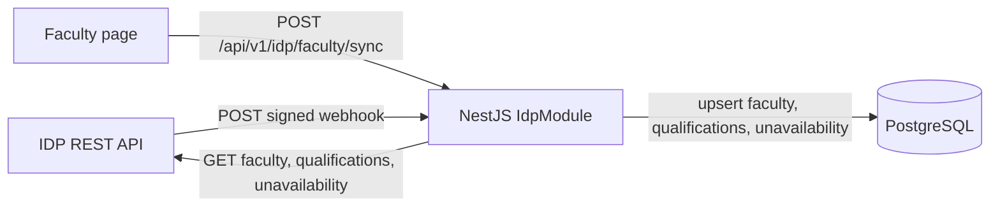

# IDP integration

CoE-NNECT exchanges faculty data with the university's **Institutional Data
Platform (IDP)** under the CoE-NNECT ↔ IDP API Contract v2.0.

Milestone 1 is implemented in the backend as the `IdpModule`. It uses
**Pattern A** from the contract: server-to-server REST pulls plus signed
inbound webhooks.

> The `packages/idp-client` workspace package is still a reserved placeholder.
> The working integration lives in `apps/backend/src/modules/idp/`. See
> [IDP client package status](../packages/idp-client.md).

## Current status

| Capability | Direction | Status |
|---|---|---|
| Faculty roster sync | IDP → CoE-NNECT | Implemented |
| Qualification sync | IDP → CoE-NNECT | Implemented |
| Unavailability sync | IDP → CoE-NNECT | Implemented |
| Faculty change webhook | IDP → CoE-NNECT | Implemented |
| Integration health check | Local | Implemented |
| "Refresh from IDP" action | User → CoE-NNECT → IDP | Implemented |
| Schedule publishing | CoE-NNECT → IDP | Milestone 2 |
| Change requests and acks | Bidirectional | Milestone 3 |
| Admin settings UI | Local | Milestone 4 |

For the session-level record of the Milestone 1 implementation, see the
[Milestone 1 checkpoint](idp-milestone-1-checkpoint.md).

## Architecture



The module has four responsibilities:

- `IdpClientService` — outbound HTTP client, timeout and error mapping.
- `IdpSyncService` — roster / qualification / unavailability sync and webhook
  application.
- `IdpSignatureGuard` — HMAC-SHA256 verification for inbound webhooks.
- `IdpController` / `IdpSyncController` — the public IDP namespace and the
  authenticated user trigger.

## Endpoints

### Inbound (IDP → CoE-NNECT)

| Method | Path | Auth | Purpose |
|---|---|---|---|
| `GET` | `/api/idp/v1/health` | Public | Integration/configuration health |
| `POST` | `/api/idp/v1/webhooks/faculty-changed` | HMAC-SHA256 | Faculty change event |

The health response reports whether the integration is enabled and whether the
base URL, API key, and webhook secret are configured. It does not expose secret
values and does not call IDP.

Webhook headers:

```text
X-Request-ID:    <uuid>            (optional; echoed in logs and errors)
X-IDP-Signature: sha256=<hex>      (HMAC-SHA256 over the raw JSON body)
X-IDP-Timestamp: <ISO 8601>        (5-minute tolerance by default)
```

### Outbound (CoE-NNECT → IDP)

| Method | Path | Purpose |
|---|---|---|
| `GET` | `{IDP_BASE_URL}/faculty?department_code=&updated_since=` | Roster pull |
| `GET` | `{IDP_BASE_URL}/faculty/{key}/qualifications` | Qualification pull |
| `GET` | `{IDP_BASE_URL}/faculty/{key}/unavailability?term_code=` | Unavailability pull |

`{key}` is `wmsu_id` when present, otherwise `employee_id`. The path names are
the indicative ones from the contract; confirm them with the IDP team before
pointing `IDP_BASE_URL` at a real deployment.

### User trigger (application API)

| Method | Path | Roles |
|---|---|---|
| `POST` | `/api/v1/idp/faculty/sync` | `college_dean`, `college_secretary`, `department_head` |

All body fields are optional:

```json
{
  "departmentCode": "CPE",
  "termCode": "2026-2027-1st",
  "includeQualifications": true,
  "includeUnavailability": true
}
```

- A department head is scoped to their own department; requesting another
  department returns `403`.
- `includeQualifications` defaults to `true`.
- `includeUnavailability` defaults to `true` when `termCode` is set.
- The Faculty page exposes this as the **Refresh from IDP** button.

The response summarises the run:

```json
{
  "data": {
    "fetched": 120,
    "created": 3,
    "updated": 8,
    "unchanged": 109,
    "skipped": 0,
    "failed": 0,
    "qualificationsAdded": 14,
    "unavailabilitySynced": 0,
    "errors": [],
    "startedAt": "2026-11-08T10:00:00.000Z",
    "finishedAt": "2026-11-08T10:00:04.000Z"
  }
}
```

## Configuration

Set these in `apps/backend/.env` (the template is in
`.env.example`):

```dotenv
IDP_ENABLED=false
IDP_BASE_URL=
IDP_API_KEY=
IDP_WEBHOOK_SECRET=
IDP_REQUEST_TIMEOUT_MS=15000
IDP_WEBHOOK_TOLERANCE_MS=300000
```

| Variable | Meaning |
|---|---|
| `IDP_ENABLED` | Master switch for outbound pulls and the refresh action |
| `IDP_BASE_URL` | IDP REST base URL, without a trailing slash |
| `IDP_API_KEY` | Bearer token for outbound requests |
| `IDP_WEBHOOK_SECRET` | Shared secret for inbound HMAC verification |
| `IDP_REQUEST_TIMEOUT_MS` | Outbound timeout, default `15000` |
| `IDP_WEBHOOK_TOLERANCE_MS` | Allowed clock skew, default `300000` (5 min) |

Store real values in the deployment environment, never in git. With
`IDP_ENABLED` false or `IDP_BASE_URL` empty, the refresh action returns `503`.
With no `IDP_WEBHOOK_SECRET`, every webhook is rejected with `401`.

## Sync semantics

### Faculty matching

- Match `wmsu_id` first, then `employee_id`.
- If both keys resolve to different rows, the record fails with
  `422 faculty_key_conflict`.
- New keys create a faculty row. CoE-NNECT-owned fields
  (`designation_id`, `classification`, `required_hours`) keep local defaults.

### Identity ownership

IDP owns and overwrites these fields on sync:

`first_name`, `last_name`, `email`, `contact`, `wmsu_id`, `employee_id`,
`dept_id`, `is_active`.

CoE-NNECT owns `designation_id`, `classification`, and `required_hours`; IDP
values for those fields are ignored.

### Sync state

- Successful apply: `sync_status='synced'`, `last_synced_at=now()`.
- Failed record: `sync_status='failed'`; `last_synced_at` is unchanged.
- A local edit to an IDP-owned identity field, or toggling active, sets
  `sync_status='pending'`.
- While a **previously synced** row is pending, incoming IDP updates are
  rejected with `409 local_edit_pending`. Rows that have never been synced
  (`last_synced_at IS NULL`) are allowed through so the first roster pull can
  adopt pre-existing records.
- A second identical pull is a no-op (`unchanged` increments).

### Qualifications

- Pulled per faculty from `GET /faculty/{key}/qualifications`.
- New rows are tagged `source_system='IDP'`.
- Local rows (`source_system=NULL`) are kept.
- `(faculty_id, subject_id)` is unique, so an existing local row is never
  replaced or re-tagged.

### Unavailability

- Pulled per faculty and term from
  `GET /faculty/{key}/unavailability?term_code=...`.
- CoE-NNECT stores weekly recurring windows (`day_of_week`, `start_time`,
  `end_time`), not date-specific exceptions.
- Sync is a full replace of `source='idp'` rows for that faculty/term.
  `source='local'` rows are never touched.
- `external_id` is the IDP idempotency key.

### Incremental pulls

The roster pull sends `updated_since` equal to the maximum
`faculty.last_synced_at`, when one exists. The first pull is full. If IDP's
clock or update semantics differ, the watermark can be revisited without
changing the payload shapes.

## Webhook security and idempotency

The webhook guard verifies:

1. `X-IDP-Timestamp` is valid ISO 8601 and within the tolerance window.
2. `X-IDP-Signature` equals `sha256=` + HMAC-SHA256 of the **raw** request body.
3. The comparison is constant-time.

`NestFactory.create(..., { rawBody: true })` is required in `main.ts`; without
it the guard fails closed.

`event_id` is the idempotency key:

- Same `event_id` and same body → `200` with `status: "duplicate"`.
- Same `event_id` and different body → `409 duplicate_key`.
- The current implementation keeps seen keys in memory for 30 days. This is
  process-local; a durable `idp_processed_event` table is a follow-up.

## Error format

IDP-namespace failures use the contract envelope:

```json
{
  "error": {
    "code": "unknown_department",
    "message": "Department code 'BSCPE' is not configured in CoE-NNECT.",
    "details": { "field": "department_code", "value": "BSCPE" },
    "request_id": "8f14e45f-ea2b-4b6e-9f3a-1c2d3e4f5a6b"
  }
}
```

Codes currently emitted: `validation_error`, `unknown_department`,
`unknown_subject`, `unknown_term`, `unknown_faculty`,
`faculty_key_conflict`, `local_edit_pending`, `duplicate_key`, and
`unauthorized`.

Bulk roster pulls do not abort on a bad record; the record is counted in
`skipped` or `failed` and its error is added to `errors[]`.

## Local development and testing

Backend checks:

```powershell
cd apps/backend
npx tsc --noEmit -p tsconfig.json
npx tsc -p tsconfig.spec.json
npx jest --runInBand
npx nest build
```

Frontend check:

```powershell
cd apps/frontend
npx tsc --noEmit
```

Targeted IDP tests:

```powershell
cd apps/backend
npx jest --runInBand test/idp.service.spec.ts test/idp-signature.guard.spec.ts
```

The tests cover HMAC acceptance/rejection, the timestamp window, roster
creation, idempotent second pulls, unknown department codes,
`local_edit_pending`, webhook dedupe / `duplicate_key`, and `faculty.created`.

### Manual webhook smoke test

```powershell
$body = '{"event_id":"evt-1","event":"faculty.updated","faculty_wmsu_id":"2019-00123","change_summary":{"email":"a@b.c"},"changed_at":"2026-11-08T10:00:00Z"}'
$ts = (Get-Date).ToUniversalTime().ToString("o")
$secret = "your-secret"
$hmac = [System.Security.Cryptography.HMACSHA256]::new([Text.Encoding]::UTF8.GetBytes($secret))
$sig = ([BitConverter]::ToString($hmac.ComputeHash([Text.Encoding]::UTF8.GetBytes($body))) -replace '-','').ToLower()

Invoke-RestMethod -Method Post -Uri http://localhost:3000/api/idp/v1/webhooks/faculty-changed `
  -ContentType 'application/json' -Body $body `
  -Headers @{ 'X-IDP-Signature' = "sha256=$sig"; 'X-IDP-Timestamp' = $ts }
```

## Open items

Still to confirm with the IDP team before production:

1. Deployment model (server, desktop, offline).
2. Auth mechanism (API key vs OAuth2 client credentials).
3. HMAC-SHA256 support and header format.
4. Faculty key coverage for every record.
5. Department code mapping.
6. Subject code format / mapping.
7. Section code format / mapping.
8. Term code format (`YYYY-YYYY-semester`).
9. Whether IDP tracks qualifications and their shape.
10. Whether IDP tracks unavailability and whether it is weekly recurring.
11. Change-request types IDP will send.
12. Retry/ack expectations.
13. Whether IDP can force schedule changes.
14. PII retention requirements.
15. Sandbox/staging URL and test credentials.

## Related documentation

- [Milestone 1 checkpoint](idp-milestone-1-checkpoint.md)
- [Backend guide](../apps/backend.md)
- [Frontend guide](../apps/frontend.md)
- [System architecture](../architecture/README.md)
- [IDP client package status](../packages/idp-client.md)
- [Testing guide](../testing.md)
