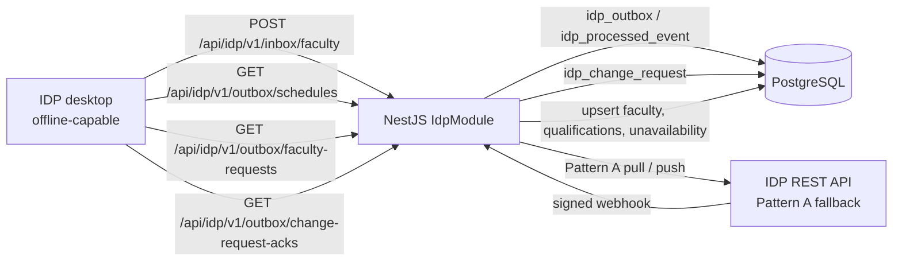

# CoE-NNECT ↔ IDP Integration

CoE-NNECT exchanges faculty data with the university's **Institutional Data Platform (IDP)** under the CoE-NNECT ↔ IDP API Contract v2.0.

The IDP deployment is a **desktop application that can work offline**. The integration therefore treats **Pattern C** as the primary transport:

- the IDP desktop pushes faculty snapshots to CoE-NNECT when it is online;
- the IDP desktop polls a durable CoE-NNECT outbox for published schedules, faculty-request statuses, and change-request acknowledgements;
- CoE-NNECT keeps every payload and idempotency key until the client has had a chance to collect it.

**Pattern A** remains as an optional fallback: server-to-server REST pulls plus signed inbound webhooks, used when a deployment exposes an IDP API that CoE-NNECT can call directly.

> The `packages/idp-client` workspace package is still a reserved placeholder. The working integration lives in `apps/backend/src/modules/idp/`. See [IDP client package status](../packages/idp-client.md).

---

## Current Status

| Capability                                       | Direction                    | Status              |
| ------------------------------------------------ | ---------------------------- | ------------------- |
| Faculty inbox push (Pattern C)                   | IDP desktop → CoE-NNECT      | Implemented         |
| Schedule outbox poll (Pattern C)                 | CoE-NNECT → IDP desktop      | Implemented         |
| Faculty-request status outbox                    | CoE-NNECT → IDP desktop      | Implemented         |
| Change-request ack outbox                        | CoE-NNECT → IDP desktop      | Implemented         |
| Durable webhook idempotency                      | Local                        | Implemented         |
| Faculty roster sync (Pattern A fallback)         | IDP → CoE-NNECT              | Implemented (fallback) |
| Qualification sync (Pattern A)                   | IDP → CoE-NNECT              | Implemented (fallback) |
| Unavailability sync (Pattern A)                  | IDP → CoE-NNECT              | Implemented (fallback) |
| Faculty change webhook                           | IDP → CoE-NNECT              | Implemented         |
| Change-request webhook                           | IDP → CoE-NNECT              | Implemented         |
| Change-request review + ack                      | User → CoE-NNECT → IDP       | Implemented         |
| Integration health check                         | Local                        | Implemented         |
| "Refresh from IDP" action                        | User → CoE-NNECT → IDP       | Implemented (fallback) |
| Schedule publishing                              | CoE-NNECT → IDP              | Implemented         |
| Admin settings UI                                | Local                        | Milestone 4         |

For the session-level record of the first implementation, see the [Milestone 1 checkpoint](idp-milestone-1-checkpoint.md). Its notes about the in-memory dedupe map are superseded by this document. Milestone 3 is recorded in the [Milestone 3 checkpoint](idp-milestone-3-checkpoint.md).

---

## Architecture



---

## 1. Who calls whom

| Direction                 | Transport | Caller        | Receiver      |
| ------------------------- | --------- | ------------- | ------------- |
| Faculty snapshot          | Pattern C | IDP desktop   | CoE-NNECT     |
| Published schedules       | Pattern C | IDP desktop   | CoE-NNECT     |
| Faculty-request statuses  | Pattern C | IDP desktop   | CoE-NNECT     |
| Change-request acks       | Pattern C | IDP desktop   | CoE-NNECT     |
| Faculty-change events     | Signed webhook | IDP       | CoE-NNECT     |
| Change requests           | Signed webhook | IDP       | CoE-NNECT     |
| Roster / qualifications / unavailability | Pattern A | CoE-NNECT | IDP |
| Schedule / faculty-request / ack push | Pattern A | CoE-NNECT | IDP |

**Pattern C is the default.** It requires no inbound HTTP on the IDP desktop, so it works when the desktop is behind NAT or temporarily offline. Pattern A is only enabled when `IDP_ENABLED=true` and `IDP_BASE_URL` is set on CoE-NNECT.

---

## 2. What CoE-NNECT needs from the IDP team

### For Pattern C (primary)

1. **Desktop base configuration**
   - The CoE-NNECT base URL you will call, e.g. `https://coe-nnect.example.edu/api`.
   - A device API key issued by CoE-NNECT (sent separately over a secure channel).
   - A webhook signing secret shared with CoE-NNECT (sent separately).
2. **Clock discipline** — webhook timestamps must be within ±5 minutes of CoE-NNECT server time (configurable with `IDP_WEBHOOK_TOLERANCE_MS`).
3. **Raw-body signing** — sign the exact JSON bytes you send, before any re-serialization.
4. **Poll state** — persist the last `next_since` value per outbox endpoint and send it back on the next poll.
5. **Public app link (optional)** — if the IDP team wants the faculty-facing app advertised on the CoE-NNECT landing page, provide the public `http(s)` URL. Leave it empty to hide the promo.

### For Pattern A (optional fallback)

1. IDP REST namespace base URL (staging and production), including `/api/idp/v1`, without a trailing slash.
2. Bearer API key for CoE-NNECT outbound calls.
3. Confirmation that these paths exist (or the agreed alternatives):
   - `GET /faculty?department_code=&updated_since=`
   - `GET /faculty/{key}/qualifications`
   - `GET /faculty/{key}/unavailability?term_code=`
   - `POST /schedules/published`
   - `POST /faculty-requests`
   - `POST /change-requests/{id}/ack`
4. Which of the eight change-request types you will actually send.
5. A staging faculty record and a staging change request we can use for end-to-end testing.

---

## 3. What to configure on CoE-NNECT

Set these in `apps/backend/.env` (template: `apps/backend/.env.example`):

```dotenv
# Pattern A fallback (leave IDP_ENABLED=false for Pattern C-only)
IDP_ENABLED=false
IDP_BASE_URL=https://adp-server-3m0u.onrender.com/api/idp/v1
IDP_API_KEY=

# Pattern C desktop access
IDP_DEVICE_API_KEY=

# Inbound webhook verification
IDP_WEBHOOK_SECRET=
IDP_REQUEST_TIMEOUT_MS=15000
IDP_WEBHOOK_TOLERANCE_MS=300000
```

- **Generate strong random values**, for example in PowerShell:

  ```powershell
  [Convert]::ToHexString([Security.Cryptography.RandomNumberGenerator]::GetBytes(32)).ToLower()
  ```

- `IDP_DEVICE_API_KEY` — shared with the IDP desktop; rotate by replacing it on both sides.
- `IDP_WEBHOOK_SECRET` — shared with the IDP sender; used only for HMAC verification.
- Never commit real values. Store them in the deployment secret manager.

Apply the IDP migrations in order if the database does not already have them:

```text
supabase/migrations/20261111000100_add_idp_processed_event.sql
supabase/migrations/20261111000200_add_idp_outbox.sql
supabase/migrations/20261111000300_add_idp_change_request.sql
```

Check readiness:

```powershell
Invoke-RestMethod http://localhost:3000/api/idp/v1/health
```

The response reports whether the device key, webhook secret, and Pattern A base URL are configured. It never returns secret values.

---

## 4. Pattern C endpoints (IDP desktop → CoE-NNECT)

All Pattern C calls send:

```text
Authorization: Bearer <IDP_DEVICE_API_KEY>
X-Request-ID:    <uuid>        (optional, echoed in logs/errors)
Content-Type:    application/json
```

### 4.1 Push a faculty snapshot

`POST /api/idp/v1/inbox/faculty`

Accepts either the contract's bare array or an envelope:

```json
{
  "faculty": [
    {
      "wmsu_id": "2019-00123",
      "employee_id": null,
      "first_name": "Juan",
      "last_name": "Dela Cruz",
      "email": "juan.delacruz@wmsu.edu.ph",
      "contact": null,
      "department_code": "CPE",
      "is_active": true
    }
  ]
}
```

A bare array is also accepted. Per-record failures do not abort the snapshot:

```json
{
  "data": {
    "received": 1,
    "created": 0,
    "updated": 1,
    "unchanged": 0,
    "skipped": 0,
    "failed": 0,
    "errors": [],
    "startedAt": "2026-11-11T10:00:00.000Z",
    "finishedAt": "2026-11-11T10:00:02.000Z"
  }
}
```

Each record follows the same matching, ownership, and sync-state rules as the Pattern A roster pull. Per-record failures are counted in `failed` or `skipped` and appended to `errors[]`. A row with a pending local edit returns `409 local_edit_pending` in that record's error entry.

### 4.2 Poll published schedules

`GET /api/idp/v1/outbox/schedules?since=<iso>&limit=<1-200>&deptCode=<code>`

`deptCode` is optional. For example, `deptCode=CPE` returns only CPE entries within each published term payload. Track a separate `next_since` cursor per department filter.

```json
{
  "data": {
    "items": [
      {
        "outbox_id": "42",
        "kind": "schedule.published",
        "idempotency_key": "77",
        "created_at": "2026-11-11T10:00:00.000Z",
        "payload": {
          "coe_nnect_version_id": "77",
          "version_number": 3,
          "term_code": "2026-2027-1st",
          "published_at": "2026-11-11T09:59:58.000Z",
          "entries": []
        }
      }
    ],
    "next_since": "2026-11-11T10:00:00.000Z",
    "server_time": "2026-11-11T10:00:05.000Z"
  }
}
```

**Rules:**

1. Dedupe on `payload.coe_nnect_version_id`.
2. Persist `next_since`; it is inclusive, so the same item may be returned again. Re-reading is harmless; skipping is not.
3. Keep polling while `items` is non-empty.
4. Schedule items are frozen at publish time and never change.

### 4.3 Fetch department class references

`GET /api/idp/v1/schedules/classes?deptCode=CPE` returns finalized or published, unflagged class rows for the selected department. The response includes `subject_code`, `section_code`, `course_title`, and `class_code` (the CoE-NNECT schedule row ID). Department codes are case-insensitive.

### 4.4 Poll faculty-request statuses

`GET /api/idp/v1/outbox/faculty-requests?since=<iso>&limit=<1-200>`

Unlike schedule items, faculty-request items are **refreshed in place**: `coe_nnect_request_id` is the idempotency key, and a new status overwrites the existing row and moves its `created_at` cursor forward. A client that polls after being offline therefore receives the latest status once, not a history of every transition. Dedupe on `payload.coe_nnect_request_id` plus `status`.

```json
{
  "data": {
    "items": [
      {
        "outbox_id": "58",
        "kind": "faculty_request.status",
        "idempotency_key": "42",
        "created_at": "2026-11-11T10:05:00.000Z",
        "payload": {
          "coe_nnect_request_id": "42",
          "requesting_dept": "CPE",
          "target_dept": "EE",
          "faculty_wmsu_id": "2019-00123",
          "subject_code": "CPE 131",
          "term_code": "2026-2027-1st",
          "status": "approved",
          "reason": "Needs to teach CPE 131 for the first semester.",
          "created_at": "2026-10-23T09:40:00.000Z"
        }
      }
    ],
    "next_since": "2026-11-11T10:05:00.000Z",
    "server_time": "2026-11-11T10:05:02.000Z"
  }
}
```

Every create, approve, reject, and cancel transition queues a status. The local approval transaction is never rolled back if IDP is unreachable: the outbox row survives and is delivered on the next poll or replay.

### 4.5 Poll change-request acknowledgements

`GET /api/idp/v1/outbox/change-request-acks?since=<iso>&limit=<1-200>`

```json
{
  "data": {
    "items": [
      {
        "outbox_id": "61",
        "kind": "change_request.ack",
        "idempotency_key": "IDP-REQ-0001",
        "created_at": "2026-11-11T10:10:00.000Z",
        "payload": {
          "idp_request_id": "IDP-REQ-0001",
          "acknowledged_by_coe_nnect_user_id": "8f14e45f-ea2b-4b6e-9f3a-1c2d3e4f5a6b",
          "action": "accepted",
          "notes": "Applied to the 2026-2027 first semester timetable.",
          "acknowledged_at": "2026-11-11T10:10:00.000Z"
        }
      }
    ],
    "next_since": "2026-11-11T10:10:00.000Z",
    "server_time": "2026-11-11T10:10:02.000Z"
  }
}
```

`action` is `accepted`, `rejected`, or `modified`. There is exactly one ack per `idp_request_id`; treat it as final.

---

## 5. Signed webhooks (IDP → CoE-NNECT)

### Headers

```text
Content-Type:    application/json
X-Request-ID:    <uuid>                 (optional)
X-IDP-Signature: sha256=<hex>
X-IDP-Timestamp: <ISO 8601>
```

- **Signature** = HMAC-SHA256 of the **raw request body bytes**, hex-encoded, prefixed with `sha256=`.
- **Timestamp** must be within ±5 minutes (configurable).
- Send the body exactly as signed; do not re-serialize after computing the HMAC.

`X-COE-NNECT-Signature` and `X-COE-NNECT-Timestamp` are accepted aliases.

`POST /api/idp/v1/webhooks/change-request` additionally accepts the shared integration key through `X-IDP-API-Key`, `X-COE-NNECT-Key`, `X-API-Key`, or `Authorization: Bearer`. The faculty-change webhook stays HMAC-only.

### 5.1 Faculty change event

`POST /api/idp/v1/webhooks/faculty-changed`

Follows contract 4.6. The event is deduplicated on its event id; a retry with the same id and body returns a duplicate result, while a different body returns `409 duplicate_key`.

### 5.2 Change request

`POST /api/idp/v1/webhooks/change-request`

Contract 4.5 requires only `idp_request_id` and `type`. Everything else is optional; CoE-NNECT applies `severity: "info"`, `details: {}`, `created_at` at receive time, and `requires_ack` based on the type.

**Example (`unavailability_change`):**

```json
{
  "idp_request_id": "IDP-REQ-0001",
  "type": "unavailability_change",
  "faculty_wmsu_id": "2019-00123",
  "faculty_employee_id": null,
  "affected_dates": ["2026-11-18"],
  "details": {
    "term_code": "2026-2027-1st",
    "day_of_week": "Monday",
    "start_time": "13:00",
    "end_time": "15:00",
    "reason": "External load"
  },
  "severity": "warning",
  "requires_ack": true,
  "created_at": "2026-11-11T10:00:00Z"
}
```

**The eight types split into two groups:**

- **Auto-accepted:** `faculty_create`, `faculty_update`, `faculty_deactivate`, `qualification_add`, `qualification_remove`. CoE-NNECT stores them as `acknowledged` for audit but does not apply them and does not put them in the review queue. If you need a return acknowledgement, set `requires_ack: true`; CoE-NNECT then queues a system ack (`acknowledged_by_coe_nnect_user_id: "0"`).
- **Pending review:** `unavailability_change`, `schedule_override`, `faculty_transfer`. These wait for a Dean, college secretary, or administrator to record `accepted`, `rejected`, or `modified`.

`schedule_override` may omit `faculty_wmsu_id` / `faculty_employee_id`; `unavailability_change` and `faculty_transfer` must identify an existing faculty record.

**Idempotency:**

| Case                                   | Response              |
| -------------------------------------- | --------------------- |
| New pending `idp_request_id`           | `200`, `status: "pending"` |
| New auto-accepted `idp_request_id`     | `200`, `status: "acknowledged"` |
| Same id + same effective body          | `200`, `status: "duplicate"` |
| Same id + different body               | `409 duplicate_key`   |

CoE-NNECT **does not apply the change automatically**. For pending types, a Dean/college secretary/administrator reviews the request and records an acknowledgement; the underlying schedule or faculty change is applied manually through CoE-NNECT screens. This is deliberate: CoE-NNECT is authoritative for schedules.

The webhook accepts HMAC-SHA256 headers or, as a fallback, the shared integration key in `X-IDP-API-Key`, `X-COE-NNECT-Key`, `X-API-Key`, or `Authorization: Bearer`. `X-COE-NNECT-Signature` / `X-COE-NNECT-Timestamp` are accepted aliases for the HMAC headers.

### 5.3 Signing examples

**Node.js:**

```js
const crypto = require('crypto');

const body = JSON.stringify(payload); // sign these exact bytes
const timestamp = new Date().toISOString();
const signature =
  'sha256=' +
  crypto.createHmac('sha256', process.env.IDP_WEBHOOK_SECRET)
    .update(body)
    .digest('hex');

await fetch(`${baseUrl}/api/idp/v1/webhooks/change-request`, {
  method: 'POST',
  headers: {
    'Content-Type': 'application/json',
    'X-IDP-Signature': signature,
    'X-IDP-Timestamp': timestamp,
    'X-Request-ID': crypto.randomUUID(),
  },
  body,
});
```

**PowerShell:**

```powershell
$body = '{"idp_request_id":"IDP-REQ-0001", ...}'
$ts = (Get-Date).ToUniversalTime().ToString("o")
$hmac = [System.Security.Cryptography.HMACSHA256]::new(
  [Text.Encoding]::UTF8.GetBytes($env:IDP_WEBHOOK_SECRET)
)
$sig = ([BitConverter]::ToString(
  $hmac.ComputeHash([Text.Encoding]::UTF8.GetBytes($body))
) -replace '-','').ToLower()

Invoke-RestMethod -Method Post `
  -Uri http://localhost:3000/api/idp/v1/webhooks/change-request `
  -ContentType 'application/json' -Body $body `
  -Headers @{ 'X-IDP-Signature' = "sha256=$sig"; 'X-IDP-Timestamp' = $ts }
```

---

## 6. Pattern A endpoints (CoE-NNECT → IDP, optional)

CoE-NNECT calls these with `Authorization: Bearer <IDP_API_KEY>` and an `X-Request-ID` per attempt. `IDP_BASE_URL` includes `/api/idp/v1`, so the paths below resolve to `/api/idp/v1/faculty`, `/api/idp/v1/schedules/published`, and so on.

| Method | Path                                    | Purpose              |
| ------ | --------------------------------------- | -------------------- |
| `GET`  | `/faculty?department_code=&updated_since=` | Roster pull          |
| `GET`  | `/faculty/{key}/qualifications`          | Qualification pull   |
| `GET`  | `/faculty/{key}/unavailability?term_code=` | Unavailability pull  |
| `POST` | `/schedules/published`                   | Published-schedule push |
| `POST` | `/faculty-requests`                      | Faculty-request status |
| `POST` | `/change-requests/{id}/ack`              | Change-request ack   |

CoE-NNECT treats `409` on a push as "already accepted" and does not retry. `429` and `5xx` are retried with bounded backoff; other `4xx` are reported and left in the outbox.

The IDP receiving side should return the contract error envelope on failure:

```json
{
  "error": {
    "code": "validation_error",
    "message": "Human-readable explanation.",
    "details": {},
    "request_id": "..."
  }
}
```

---

## 7. Error codes CoE-NNECT returns

| HTTP | Code                | Meaning                                                  |
| ---- | ------------------- | -------------------------------------------------------- |
| 400  | `validation_error`  | Missing/invalid field or body shape                      |
| 401  | `unauthorized`      | Missing/invalid device key, signature, or timestamp      |
| 403  | `forbidden`         | Role is not allowed to review/ack                        |
| 409  | `duplicate_key`     | Same idempotency key with a different body or decision   |
| 409  | `local_edit_pending` | Faculty row has an unreconciled local edit               |
| 422  | `unknown_department` | Department code does not resolve                        |
| 422  | `unknown_subject`   | Subject code does not resolve                            |
| 422  | `unknown_section`   | Section code does not resolve                            |
| 422  | `unknown_term`      | Term code does not resolve                               |
| 422  | `unknown_faculty`   | Faculty key does not resolve                             |
| 422  | `unknown_designation` | Designation id does not resolve                        |
| 422  | `faculty_key_conflict` | `wmsu_id` and `employee_id` point to different rows     |
| 500  | `internal_error`    | Unexpected server failure                                |

Bulk faculty pushes do not abort on a bad record; the record is counted in `skipped` or `failed` and its error is added to `errors[]`.

---

## 8. End-to-end test plan

Run this against a CoE-NNECT staging environment before production.

### 8.1 Prerequisites

- CoE-NNECT staging base URL and device key.
- Webhook secret.
- At least one department code (`CPE`), subject code (`CPE 131`), and term code (`2026-2027-1st`) that exist in staging.
- A Dean/secretary/administrator JWT for the review step.

### 8.2 Steps

1. **Health**

   ```powershell
   Invoke-RestMethod "$BASE/api/idp/v1/health"
   ```

   Confirm the device key and webhook secret are reported as configured.

2. **Faculty inbox**

   ```powershell
   $headers = @{
     Authorization = "Bearer $env:IDP_DEVICE_API_KEY"
     'Content-Type' = 'application/json'
   }
   $body = '{"faculty":[{"wmsu_id":"2019-00123","first_name":"Juan","last_name":"Dela Cruz","department_code":"CPE","is_active":true}]}'
   Invoke-RestMethod -Method Post -Uri "$BASE/api/idp/v1/inbox/faculty" `
     -Headers $headers -Body $body
   ```

   Expect `received: 1` and `failed: 0`.

3. **Schedule outbox**

   ```powershell
   Invoke-RestMethod -Uri "$BASE/api/idp/v1/outbox/schedules" -Headers $headers
   ```

   An empty `items` array is fine before the first publish.

4. **Change request**

   Send the signed example from section 5.2. Expect `status: "pending"`. Resend the exact same body: expect `status: "duplicate"`. Change a field and resend: expect `409 duplicate_key`.

5. **Review + ack**

   ```powershell
   $jwt = $env:COE_NNECT_JWT
   Invoke-RestMethod -Uri "$BASE/api/v1/idp/change-requests?status=pending" `
     -Headers @{ Authorization = "Bearer $jwt" }

   Invoke-RestMethod -Method Post `
     -Uri "$BASE/api/v1/idp/change-requests/IDP-REQ-0001/ack" `
     -ContentType 'application/json' `
     -Headers @{ Authorization = "Bearer $jwt" } `
     -Body '{"action":"accepted","notes":"Staging verification."}'
   ```

6. **Ack outbox**

   ```powershell
   Invoke-RestMethod -Uri "$BASE/api/idp/v1/outbox/change-request-acks" -Headers $headers
   ```

   Confirm the ack payload for `IDP-REQ-0001`.

7. **Cursor replay**

   Poll with the returned `next_since`; confirm the same item is returned (inclusive cursor) and that your client dedupes it.

8. **Failure paths**

   - Missing device key → `401 unauthorized`.
   - Wrong HMAC → `401 unauthorized`.
   - Stale timestamp (>5 min) → `401 unauthorized`.
   - Unknown term/faculty/subject → `422` with the matching code.

### 8.3 Acceptance checklist

- [ ] Health reports device key and webhook secret configured.
- [ ] Faculty snapshot applies without per-record failures.
- [ ] Schedule poll returns published items and advances `next_since`.
- [ ] Change-request retry is idempotent; conflicting reuse is `409`.
- [ ] Reviewer can list and acknowledge a pending request.
- [ ] Ack appears in the ack outbox exactly once.
- [ ] Invalid auth/signature/timestamp is rejected with `401`.
- [ ] Unknown references are rejected with the documented `422` code.

---

## 9. Local testing without the IDP team

You can exercise every CoE-NNECT endpoint with curl/PowerShell and a fake IDP.

**Pattern C only** — no fake IDP needed. Use the device key and webhook secret from `apps/backend/.env` and run the section 8 steps against `http://localhost:3000`.

**Pattern A** — point `IDP_BASE_URL` at a small mock server (for example a local Express/Flask app) that returns the contract payloads, set `IDP_ENABLED=true`, then use the **Refresh from IDP** action or `POST /api/v1/idp/faculty/sync`.

The backend test suite already covers both patterns with fakes:

```powershell
cd apps/backend
npx jest --runInBand test/idp.service.spec.ts test/idp-outbox.service.spec.ts test/idp-schedule-publisher.service.spec.ts test/idp-faculty-request-publisher.service.spec.ts test/idp-change-request.service.spec.ts test/idp-device.guard.spec.ts test/idp-signature.guard.spec.ts
```

---

## 10. Open items (to confirm with the IDP team)

1. Device-key distribution and rotation process.
2. Faculty key coverage for every record.
3. Department code mapping.
4. Subject code format / mapping.
5. Section code format / mapping.
6. Term code format (`YYYY-YYYY-semester`).
7. Whether IDP tracks qualifications and their shape.
8. Whether IDP tracks unavailability and whether it is weekly recurring.
9. Retry/ack expectations and the offline timestamp tolerance (contract allows up to 24 hours).
10. PII retention requirements.
11. Sandbox/staging URL and test credentials.

The contract's pending-change-request pull (`GET /api/idp/v1/integration/change-requests/pending`) is intentionally not implemented yet because the response schema is not specified. Reviewers use the local review queue, and the IDP desktop collects acks from the Pattern C outbox.

---

## 11. Related documentation

- [Milestone 1 checkpoint](idp-milestone-1-checkpoint.md)
- [Milestone 3 checkpoint](idp-milestone-3-checkpoint.md)
- [Integration handoff and test plan](idp-handoff.md)
- [Backend guide](../apps/backend.md)
- [Frontend guide](../apps/frontend.md)
- [System architecture](../architecture/README.md)
- [IDP client package status](../packages/idp-client.md)
- [Testing guide](../testing.md)