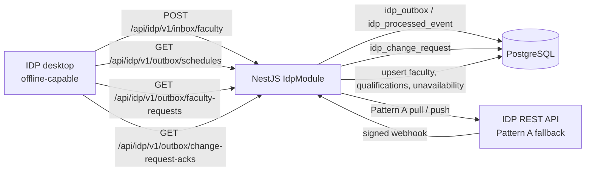

# IDP integration

CoE-NNECT exchanges faculty data with the university's **Institutional Data
Platform (IDP)** under the CoE-NNECT ↔ IDP API Contract v2.0.

The IDP deployment is a **desktop application that can work offline**. The
integration therefore treats **Pattern C** as the primary transport:

- the IDP desktop pushes faculty snapshots to CoE-NNECT when it is online;
- the IDP desktop polls a durable CoE-NNECT outbox for published schedules,
  faculty-request statuses, and change-request acknowledgements;
- CoE-NNECT keeps every payload and idempotency key until the client has had a
  chance to collect it.

**Pattern A** remains as an optional fallback: server-to-server REST pulls plus
signed inbound webhooks, used when a deployment exposes an IDP API that
CoE-NNECT can call directly.

> The `packages/idp-client` workspace package is still a reserved placeholder.
> The working integration lives in `apps/backend/src/modules/idp/`. See
> [IDP client package status](../packages/idp-client.md).

## Current status

| Capability                       | Direction               | Status                 |
| -------------------------------- | ----------------------- | ---------------------- |
| Faculty inbox push (Pattern C)   | IDP desktop → CoE-NNECT | Implemented            |
| Schedule outbox poll (Pattern C) | CoE-NNECT → IDP desktop | Implemented            |
| Faculty-request status outbox    | CoE-NNECT → IDP desktop | Implemented            |
| Change-request ack outbox        | CoE-NNECT → IDP desktop | Implemented            |
| Durable webhook idempotency      | Local                   | Implemented            |
| Faculty roster sync (Pattern A)  | IDP → CoE-NNECT         | Implemented (fallback) |
| Qualification sync (Pattern A)   | IDP → CoE-NNECT         | Implemented (fallback) |
| Unavailability sync (Pattern A)  | IDP → CoE-NNECT         | Implemented (fallback) |
| Faculty change webhook           | IDP → CoE-NNECT         | Implemented            |
| Change-request webhook           | IDP → CoE-NNECT         | Implemented            |
| Change-request review + ack      | User → CoE-NNECT → IDP  | Implemented            |
| Integration health check         | Local                   | Implemented            |
| "Refresh from IDP" action        | User → CoE-NNECT → IDP  | Implemented (fallback) |
| Schedule publishing              | CoE-NNECT → IDP         | Implemented            |
| Admin settings UI                | Local                   | Milestone 4            |

For the session-level record of the first implementation, see the
[Milestone 1 checkpoint](idp-milestone-1-checkpoint.md). Its notes about the
in-memory dedupe map are superseded by this document. Milestone 3 is recorded
in the [Milestone 3 checkpoint](idp-milestone-3-checkpoint.md).

## Architecture



The module has these responsibilities:

- `IdpClientService` — outbound Pattern A HTTP client, timeout and error mapping.
- `IdpSyncService` — faculty inbox, roster / qualification / unavailability
  sync, webhook application, and the 30-day idempotency sweep.
- `IdpOutboxService` — durable queue for published schedules, faculty-request
  statuses, and change-request acknowledgements.
- `IdpSchedulePublisherService` — maps a schedule version to the contract 4.4
  payload, queues it, and optionally pushes it.
- `IdpFacultyRequestPublisherService` — maps a faculty request to the contract
  4.5 payload and refreshes its status in the outbox.
- `IdpChangeRequestService` — validates and stores inbound change requests and
  records exactly one reviewer acknowledgement per `idp_request_id`.
- `IdpDeviceGuard` — per-device bearer authentication for Pattern C routes.
- `IdpSignatureGuard` — HMAC-SHA256 verification for inbound webhooks.
- `IdpController` / `IdpSyncController` — the public IDP namespace and the
  authenticated user triggers.

## Endpoints

### Inbound (IDP → CoE-NNECT)

| Method | Path                                         | Auth              | Purpose                          |
| ------ | -------------------------------------------- | ----------------- | -------------------------------- |
| `GET`  | `/api/idp/v1/health`                         | Public            | Integration/configuration health |
| `POST` | `/api/idp/v1/webhooks/faculty-changed`       | HMAC-SHA256       | Faculty change event             |
| `POST` | `/api/idp/v1/webhooks/change-request`        | HMAC-SHA256       | Change request (contract 4.7)    |
| `POST` | `/api/idp/v1/inbox/faculty`                  | Device bearer key | Pattern C faculty snapshot       |
| `GET`  | `/api/idp/v1/outbox/schedules?since=&limit=` | Device bearer key | Pattern C schedule poll          |
| `GET`  | `/api/idp/v1/outbox/faculty-requests?since=&limit=` | Device bearer key | Pattern C faculty-request poll |
| `GET`  | `/api/idp/v1/outbox/change-request-acks?since=&limit=` | Device bearer key | Pattern C change-request-ack poll |

Pattern C calls send:

```text
Authorization: Bearer <IDP_DEVICE_API_KEY>
X-Request-ID:    <uuid>            (optional; echoed in logs and errors)
```

If `IDP_DEVICE_API_KEY` is not configured, every Pattern C call fails closed
with `401 unauthorized`. The health response reports whether the device key and
webhook secret are present, but never returns their values.

Webhook headers:

```text
X-Request-ID:    <uuid>            (optional; echoed in logs and errors)
X-IDP-Signature: sha256=<hex>      (HMAC-SHA256 over the raw JSON body)
X-IDP-Timestamp: <ISO 8601>        (5-minute online tolerance by default)
```

### Pattern C faculty inbox

`POST /api/idp/v1/inbox/faculty` accepts either the contract's bare array or an
envelope:

```json
{
  "faculty": [
    {
      "wmsu_id": "2019-00123",
      "employee_id": null,
      "first_name": "Juan",
      "last_name": "Dela Cruz",
      "email": "juan@wmsu.edu.ph",
      "contact": null,
      "department_code": "CPE",
      "is_active": true
    }
  ]
}
```

Each record follows the same matching, ownership, and sync-state rules as the
Pattern A roster pull (see [Sync semantics](#sync-semantics)). Per-record
failures do not abort the snapshot; they are counted in `failed` or `skipped`
and appended to `errors[]`.

```json
{
  "data": {
    "received": 120,
    "created": 3,
    "updated": 8,
    "unchanged": 109,
    "skipped": 0,
    "failed": 0,
    "errors": [],
    "startedAt": "2026-11-11T10:00:00.000Z",
    "finishedAt": "2026-11-11T10:00:02.000Z"
  }
}
```

A row with a pending local edit returns `409 local_edit_pending` in that
record's error entry, not as a request-level failure.

### Pattern C schedule outbox

`GET /api/idp/v1/outbox/schedules?since=<iso>&limit=<n>` returns published
schedules oldest first. `since` is inclusive and `limit` is 1-200 (default 50).

```json
{
  "data": {
    "items": [
      {
        "outbox_id": "42",
        "kind": "schedule.published",
        "idempotency_key": "77",
        "created_at": "2026-11-11T10:00:00.000Z",
        "payload": {
          "coe_nnect_version_id": "77",
          "version_number": 3,
          "term_code": "2026-2027-1st",
          "published_at": "2026-11-11T09:59:58.000Z",
          "entries": []
        }
      }
    ],
    "next_since": "2026-11-11T10:00:00.000Z",
    "server_time": "2026-11-11T10:00:05.000Z"
  }
}
```

Client rules:

1. Dedupe on `payload.coe_nnect_version_id` (the same value as
   `idempotency_key` for schedule items).
2. Persist `next_since` and send it on the next poll.
3. `next_since` may repeat the last item's timestamp. Re-reading one item is
   harmless; skipping a same-timestamp row is not.
4. `limit` only bounds a page. Keep polling while `items` is non-empty to catch
   up after a long offline period.

Outbox items are append-only and frozen at first publish. Re-publishing the same
`schedule_version` returns the original payload and the same `outbox_id`, even
if live schedule rows changed afterwards. This guarantees that an offline
client receives exactly what the Dean published.

### Pattern C faculty-request status outbox

`GET /api/idp/v1/outbox/faculty-requests?since=<iso>&limit=<n>` returns the
current status of every faculty request CoE-NNECT has published (contract 4.5 /
5.5).

```json
{
  "data": {
    "items": [
      {
        "outbox_id": "58",
        "kind": "faculty_request.status",
        "idempotency_key": "42",
        "created_at": "2026-11-11T10:05:00.000Z",
        "payload": {
          "coe_nnect_request_id": "42",
          "requesting_dept": "CPE",
          "target_dept": "EE",
          "faculty_wmsu_id": "2019-00123",
          "subject_code": "CPE 131",
          "term_code": "2026-2027-1st",
          "status": "approved",
          "reason": "Needs to teach CPE 131 for the first semester.",
          "created_at": "2026-10-23T09:40:00.000Z"
        }
      }
    ],
    "next_since": "2026-11-11T10:05:00.000Z",
    "server_time": "2026-11-11T10:05:02.000Z"
  }
}
```

Unlike schedule items, faculty-request items are **refreshed in place**:
`coe_nnect_request_id` is the idempotency key, and a new status overwrites the
existing row and moves its `created_at` cursor forward. A client that polls
after being offline therefore receives the latest status once, not a history of
every transition. Dedupe on `payload.coe_nnect_request_id` plus `status`.

Every create, approve, reject, and cancel transition queues a status. The local
approval transaction is never rolled back if IDP is unreachable: the outbox row
survives and is delivered on the next poll or replay.

### Change requests and acknowledgements

Change requests implement contract 4.7, 4.7.1, 4.8, and 5.7.

**Inbound webhook.** `POST /api/idp/v1/webhooks/change-request` accepts the
signed change-request body. `idp_request_id` is the idempotency key:

- same `idp_request_id` and same body → `200` with `status: "duplicate"`;
- same `idp_request_id` and different body → `409 duplicate_key`;
- new id → `200` with `status: "pending"`.

The request is stored in `public.idp_change_request` and is not applied
automatically. The eight contract types are validated against local reference
data: `faculty_create`, `faculty_update`, `faculty_deactivate`,
`faculty_transfer`, `qualification_add`, `qualification_remove`,
`unavailability_change`, and `schedule_override`. Unknown faculty, department,
subject, term, or section references fail with the matching `422` code.

**Review API.** Dean, college secretary, and administrator roles can list,
read, and acknowledge requests:

| Method | Path                                    | Purpose                     |
| ------ | --------------------------------------- | --------------------------- |
| `GET`  | `/api/v1/idp/change-requests`           | List, filter by status/type |
| `GET`  | `/api/v1/idp/change-requests/:id`       | Read one request            |
| `POST` | `/api/v1/idp/change-requests/:id/ack`   | Record the reviewer decision |

```json
{
  "action": "accepted",
  "notes": "Applied to the 2026-2027 first semester timetable."
}
```

`action` is `accepted`, `rejected`, or `modified`. Acknowledging records the
decision; the reviewer still applies the underlying schedule or faculty change
through the existing screens. Keeping the proposal separate from the
authoritative schedule prevents an IDP message from mutating live data without
review.

**Exactly-once ack.** Each `idp_request_id` accepts one decision. Repeating the
same action and notes returns the stored ack with `duplicate: true`. A
different decision returns `409 duplicate_key`. The ack is written to the
durable outbox under `kind='change_request.ack'` and, when Pattern A is
configured, pushed to `POST {IDP_BASE}/change-requests/{id}/ack`.

### Pattern C change-request ack outbox

`GET /api/idp/v1/outbox/change-request-acks?since=<iso>&limit=<n>` returns the
acks CoE-NNECT has issued:

```json
{
  "data": {
    "items": [
      {
        "outbox_id": "61",
        "kind": "change_request.ack",
        "idempotency_key": "IDP-REQ-0001",
        "created_at": "2026-11-11T10:10:00.000Z",
        "payload": {
          "idp_request_id": "IDP-REQ-0001",
          "acknowledged_by_coe_nnect_user_id": "8f14e45f-ea2b-4b6e-9f3a-1c2d3e4f5a6b",
          "action": "accepted",
          "notes": "Applied to the 2026-2027 first semester timetable.",
          "acknowledged_at": "2026-11-11T10:10:00.000Z"
        }
      }
    ],
    "next_since": "2026-11-11T10:10:00.000Z",
    "server_time": "2026-11-11T10:10:02.000Z"
  }
}
```

Ack items are written once per `idp_request_id`. Dedupe on
`payload.idp_request_id`; the IDP desktop should treat the ack as final.

### Outbound (CoE-NNECT → IDP, Pattern A fallback)

| Method | Path                                                     | Purpose                 |
| ------ | -------------------------------------------------------- | ----------------------- |
| `GET`  | `{IDP_BASE_URL}/faculty?department_code=&updated_since=` | Roster pull             |
| `GET`  | `{IDP_BASE_URL}/faculty/{key}/qualifications`            | Qualification pull      |
| `GET`  | `{IDP_BASE_URL}/faculty/{key}/unavailability?term_code=` | Unavailability pull     |
| `POST` | `{IDP_BASE_URL}/schedules/published`                     | Published-schedule push |
| `POST` | `{IDP_BASE_URL}/faculty-requests`                        | Faculty-request status  |
| `POST` | `{IDP_BASE_URL}/change-requests/{id}/ack`                | Change-request ack      |

`{key}` is `wmsu_id` when present, otherwise `employee_id`. The path names are
the indicative ones from the contract; confirm them with the IDP team before
pointing `IDP_BASE_URL` at a real deployment.

`POST /api/v1/idp/schedules/publish` always queues the payload to the outbox
first. When Pattern A is configured, it also pushes immediately. A push failure
does not roll back the local publish or remove the queued item; the result
reports `queued: true`, `delivered: false`, and the upstream error.

Faculty-request statuses and change-request acks follow the same
queue-first rule. Approval responses are never blocked by an IDP outage.

### User trigger (application API)

| Method | Path                                      | Roles                                                  |
| ------ | ----------------------------------------- | ------------------------------------------------------ |
| `POST` | `/api/v1/idp/faculty/sync`                | `college_dean`, `college_secretary`, `department_head` |
| `GET`  | `/api/v1/idp/schedules/payload?termCode=` | `college_dean`, `college_secretary`, `administrator`   |
| `POST` | `/api/v1/idp/schedules/publish`           | `college_dean`, `college_secretary`, `administrator`   |
| `GET`  | `/api/v1/idp/change-requests`             | `college_dean`, `college_secretary`, `administrator`   |
| `GET`  | `/api/v1/idp/change-requests/:id`         | `college_dean`, `college_secretary`, `administrator`   |
| `POST` | `/api/v1/idp/change-requests/:id/ack`     | `college_dean`, `college_secretary`, `administrator`   |

All sync body fields are optional:

```json
{
  "departmentCode": "CPE",
  "termCode": "2026-2027-1st",
  "includeQualifications": true,
  "includeUnavailability": true
}
```

- A department head is scoped to their own department; requesting another
  department returns `403`.
- `includeQualifications` defaults to `true`.
- `includeUnavailability` defaults to `true` when `termCode` is set.
- The Faculty page exposes this as the **Refresh from IDP** button.

## Configuration

Set these in `apps/backend/.env` (the template is in `.env.example`):

```dotenv
# Pattern A fallback
IDP_ENABLED=false
IDP_BASE_URL=
IDP_API_KEY=

# Pattern C desktop access
IDP_DEVICE_API_KEY=

# Webhooks
IDP_WEBHOOK_SECRET=
IDP_REQUEST_TIMEOUT_MS=15000
IDP_WEBHOOK_TOLERANCE_MS=300000
```

| Variable                   | Meaning                                                                    |
| -------------------------- | -------------------------------------------------------------------------- |
| `IDP_ENABLED`              | Master switch for Pattern A outbound pulls, pushes, and the refresh action |
| `IDP_BASE_URL`             | IDP REST base URL, without a trailing slash                                |
| `IDP_API_KEY`              | Bearer token for outbound Pattern A requests                               |
| `IDP_DEVICE_API_KEY`       | Per-device bearer key the IDP desktop presents on inbox/outbox calls       |
| `IDP_WEBHOOK_SECRET`       | Shared secret for inbound HMAC verification                                |
| `IDP_REQUEST_TIMEOUT_MS`   | Outbound timeout, default `15000`                                          |
| `IDP_WEBHOOK_TOLERANCE_MS` | Allowed clock skew, default `300000` (5 min)                               |

Readiness:

- **Pattern C inbound** is ready when `IDP_DEVICE_API_KEY` and
  `IDP_WEBHOOK_SECRET` are both set. It does not depend on `IDP_ENABLED`.
- **Pattern A outbound** is ready when `IDP_ENABLED=true` and `IDP_BASE_URL` is
  set.
- With `IDP_ENABLED` false or `IDP_BASE_URL` empty, the refresh action returns
  `503`.
- With no `IDP_WEBHOOK_SECRET`, every webhook is rejected with `401`.

Store real values in the deployment environment, never in git. Rotate the
device key by replacing `IDP_DEVICE_API_KEY` and distributing the new value to
the IDP team through a secure channel.

## Sync semantics

### Faculty matching

- Match `wmsu_id` first, then `employee_id`.
- If both keys resolve to different rows, the record fails with
  `422 faculty_key_conflict`.
- New keys create a faculty row. CoE-NNECT-owned fields
  (`designation_id`, `classification`, `required_hours`) keep local defaults.
- The same rules apply to Pattern A pulls and Pattern C inbox records.

### Identity ownership

IDP owns and overwrites these fields on sync:

`first_name`, `last_name`, `email`, `contact`, `wmsu_id`, `employee_id`,
`dept_id`, `is_active`.

CoE-NNECT owns `designation_id`, `classification`, and `required_hours`; IDP
values for those fields are ignored.

### Sync state

- Successful apply: `sync_status='synced'`, `last_synced_at=now()`.
- Failed record: `sync_status='failed'`; `last_synced_at` is unchanged.
- A local edit to an IDP-owned identity field, or toggling active, sets
  `sync_status='pending'`.
- While a **previously synced** row is pending, incoming IDP updates are
  rejected with `409 local_edit_pending`. Rows that have never been synced
  (`last_synced_at IS NULL`) are allowed through so the first roster pull can
  adopt pre-existing records.
- A second identical pull or inbox push is a no-op (`unchanged` increments).

### Qualifications

- Pulled per faculty from `GET /faculty/{key}/qualifications` (Pattern A).
- New rows are tagged `source_system='IDP'`.
- Local rows (`source_system=NULL`) are kept.
- `(faculty_id, subject_id)` is unique, so an existing local row is never
  replaced or re-tagged.

### Unavailability

- Pulled per faculty and term from
  `GET /faculty/{key}/unavailability?term_code=...` (Pattern A).
- CoE-NNECT stores weekly recurring windows (`day_of_week`, `start_time`,
  `end_time`), not date-specific exceptions.
- Sync is a full replace of `source='idp'` rows for that faculty/term.
  `source='local'` rows are never touched.
- `external_id` is the IDP idempotency key.

### Incremental pulls

The Pattern A roster pull sends `updated_since` equal to the maximum
`faculty.last_synced_at`, when one exists. The first pull is full. Pattern C
pushes are snapshots; the client decides how much of the roster to send, and
CoE-NNECT applies each record idempotently.

## Webhook security and idempotency

The webhook guard verifies:

1. `X-IDP-Timestamp` is valid ISO 8601 and within the tolerance window.
2. `X-IDP-Signature` equals `sha256=` + HMAC-SHA256 of the **raw** request body.
3. The comparison is constant-time.

`NestFactory.create(..., { rawBody: true })` is required in `main.ts`; without
it the guard fails closed.

`event_id` is the idempotency key and is persisted in
`public.idp_processed_event`:

- Same `event_id` and same body hash → `200` with `status: "duplicate"`.
- Same `event_id` and different body hash → `409 duplicate_key`.
- Records survive process restarts and are shared by every backend instance.
- Keys are retained for 30 days. A nightly 03:00 sweep deletes older rows.

The unique primary key makes a concurrent double-delivery safe: the insert
race is converted into the same duplicate answer instead of a `500`.

Schedule idempotency uses a separate table, `public.idp_outbox`, with a unique
`(kind, idempotency_key)` pair.

## Database objects

| Table                        | Purpose                                      | Retention                        |
| ---------------------------- | -------------------------------------------- | -------------------------------- |
| `public.idp_processed_event` | Inbound webhook/event idempotency            | 30 days, nightly sweep           |
| `public.idp_outbox`          | Outbound payloads for polling clients        | No automatic expiry              |
| `public.idp_change_request`  | Inbound change requests and their one ack    | Retained for review/audit        |

`public.idp_outbox` holds three kinds: `schedule.published` (frozen,
append-only), `faculty_request.status` (one row per request, refreshed in
place), and `change_request.ack` (one row per `idp_request_id`).

All three tables have RLS enabled with no client policies and no
anon/authenticated grants. Only the NestJS API connects through `DATABASE_URL`,
so direct Supabase clients cannot read or tamper with integration state.

## Public-page exposure

The public landing page uses a separate read-only API under `/api/v1/public/*`.
It exposes only published schedules, aggregate counts, and faculty names,
departments, designations, and an IDP-linked badge. The integration card reports
only booleans for whether each credential is configured, including
`deviceApiKeyConfigured`. It never returns IDP credentials, API keys, device
keys, webhook secrets, internal integration URLs, or faculty
email/contact/employee/WMSU identifiers. Keep any new public field review
focused on that boundary; the existing Swagger docs remain gated in production
by `ENABLE_SWAGGER=true` plus basic auth.

## Error format

IDP-namespace failures use the contract envelope:

```json
{
  "error": {
    "code": "unknown_department",
    "message": "Department code 'BSCPE' is not configured in CoE-NNECT.",
    "details": { "field": "department_code", "value": "BSCPE" },
    "request_id": "8f14e45f-ea2b-4b6e-9f3a-1c2d3e4f5a6b"
  }
}
```

Codes currently emitted: `validation_error`, `unknown_department`,
`unknown_subject`, `unknown_section`, `unknown_term`, `unknown_faculty`,
`faculty_key_conflict`, `local_edit_pending`, `duplicate_key`,
`unauthorized`, and `internal_error`.

Bulk faculty pushes do not abort on a bad record; the record is counted in
`skipped` or `failed` and its error is added to `errors[]`.

## Local development and testing

Backend checks:

```powershell
cd apps/backend
npx tsc --noEmit -p tsconfig.json
npx tsc -p tsconfig.spec.json
npx jest --runInBand
npx nest build
```

Frontend check:

```powershell
cd apps/frontend
npx tsc --noEmit
```

Targeted IDP tests:

```powershell
cd apps/backend
npx jest --runInBand test/idp.service.spec.ts test/idp-outbox.service.spec.ts test/idp-schedule-publisher.service.spec.ts test/idp-faculty-request-publisher.service.spec.ts test/idp-change-request.service.spec.ts test/idp-device.guard.spec.ts test/idp-signature.guard.spec.ts
```

The tests cover HMAC acceptance/rejection, the timestamp window, device-key
auth, roster creation, idempotent second pulls, unknown department codes,
`local_edit_pending`, durable webhook dedupe / `duplicate_key`, the 30-day
sweep, faculty inbox per-record failures, outbox enqueue/freeze/poll
semantics, in-place faculty-request status refresh, change-request validation,
exactly-once acks, and Pattern A push fallback.

### Manual Pattern C smoke test

```powershell
$headers = @{ Authorization = "Bearer $env:IDP_DEVICE_API_KEY" }

# Push a faculty snapshot
$faculty = @{
  faculty = @(
    @{
      wmsu_id = '2019-00123'
      employee_id = $null
      first_name = 'Juan'
      last_name = 'Dela Cruz'
      email = 'juan@wmsu.edu.ph'
      department_code = 'CPE'
      is_active = $true
    }
  )
} | ConvertTo-Json -Depth 5

Invoke-RestMethod -Method Post -Uri http://localhost:3000/api/idp/v1/inbox/faculty `
  -ContentType 'application/json' -Body $faculty -Headers $headers

# Poll the schedule outbox
Invoke-RestMethod -Uri 'http://localhost:3000/api/idp/v1/outbox/schedules?limit=50' `
  -Headers $headers
```

### Manual webhook smoke test

```powershell
$body = '{"event_id":"evt-1","event":"faculty.updated","faculty_wmsu_id":"2019-00123","change_summary":{"email":"a@b.c"},"changed_at":"2026-11-08T10:00:00Z"}'
$ts = (Get-Date).ToUniversalTime().ToString("o")
$secret = "your-secret"
$hmac = [System.Security.Cryptography.HMACSHA256]::new([Text.Encoding]::UTF8.GetBytes($secret))
$sig = ([BitConverter]::ToString($hmac.ComputeHash([Text.Encoding]::UTF8.GetBytes($body))) -replace '-','').ToLower()

Invoke-RestMethod -Method Post -Uri http://localhost:3000/api/idp/v1/webhooks/faculty-changed `
  -ContentType 'application/json' -Body $body `
  -Headers @{ 'X-IDP-Signature' = "sha256=$sig"; 'X-IDP-Timestamp' = $ts }
```

### Manual change-request smoke test

```powershell
$body = '{"idp_request_id":"IDP-REQ-0001","type":"unavailability_change","faculty_wmsu_id":"2019-00123","faculty_employee_id":null,"affected_dates":["2026-11-18"],"details":{"term_code":"2026-2027-1st","day_of_week":"Monday","start_time":"13:00","end_time":"15:00","reason":"External load"},"severity":"warning","requires_ack":true,"created_at":"2026-11-11T10:00:00Z"}'
$ts = (Get-Date).ToUniversalTime().ToString("o")
$secret = "your-secret"
$hmac = [System.Security.Cryptography.HMACSHA256]::new([Text.Encoding]::UTF8.GetBytes($secret))
$sig = ([BitConverter]::ToString($hmac.ComputeHash([Text.Encoding]::UTF8.GetBytes($body))) -replace '-','').ToLower()

Invoke-RestMethod -Method Post -Uri http://localhost:3000/api/idp/v1/webhooks/change-request `
  -ContentType 'application/json' -Body $body `
  -Headers @{ 'X-IDP-Signature' = "sha256=$sig"; 'X-IDP-Timestamp' = $ts }

# Review and acknowledge as a Dean/secretary/administrator (JWT required)
Invoke-RestMethod -Method Get -Uri 'http://localhost:3000/api/v1/idp/change-requests?status=pending' `
  -Headers @{ Authorization = "Bearer $env:COE_NNECT_JWT" }

Invoke-RestMethod -Method Post -Uri 'http://localhost:3000/api/v1/idp/change-requests/IDP-REQ-0001/ack' `
  -ContentType 'application/json' `
  -Headers @{ Authorization = "Bearer $env:COE_NNECT_JWT" } `
  -Body '{"action":"accepted","notes":"Applied to the timetable."}'

# Poll the ack outbox as the IDP desktop
Invoke-RestMethod -Uri 'http://localhost:3000/api/idp/v1/outbox/change-request-acks' `
  -Headers @{ Authorization = "Bearer $env:IDP_DEVICE_API_KEY" }
```

## Open items

Still to confirm with the IDP team before a live sync:

1. Device-key distribution and rotation process.
2. HMAC-SHA256 support and header format for desktop-originated webhooks.
3. Faculty key coverage for every record.
4. Department code mapping.
5. Subject code format / mapping.
6. Section code format / mapping.
7. Term code format (`YYYY-YYYY-semester`).
8. Whether IDP tracks qualifications and their shape.
9. Whether IDP tracks unavailability and whether it is weekly recurring.
10. Which change-request types IDP will actually send (all eight are accepted).
11. Retry/ack expectations and the offline timestamp tolerance (contract allows
    up to 24 hours).
12. Whether IDP expects CoE-NNECT to apply a change automatically or only
    acknowledge it (current behaviour: reviewer decision, manual application).
13. PII retention requirements.
14. Sandbox/staging URL and test credentials.

## Related documentation

- [Milestone 1 checkpoint](idp-milestone-1-checkpoint.md)
- [Milestone 3 checkpoint](idp-milestone-3-checkpoint.md)
- [Integration handoff and test plan](idp-handoff.md)
- [Backend guide](../apps/backend.md)
- [Frontend guide](../apps/frontend.md)
- [System architecture](../architecture/README.md)
- [IDP client package status](../packages/idp-client.md)
- [Testing guide](../testing.md)
